<div align="center">


# 페어리 (fairy)

**화면 위를 돌아다니는 페어리가 할 일, 일정, 메모를 같이 챙겨 주는 데스크톱 비서예요.**

맥과 윈도우용이에요(리눅스는 시험판). 홈페이지는 [fairy.moilga.com](https://fairy.moilga.com)

[**받기**](https://github.com/milcho0604/fairy-releases/releases/latest) | [설치 안내](docs/install.md) | [사용 가이드](docs/guide.md) | [변경 이력](CHANGELOG.md)

</div>

> 예전 이름은 짝꿍(Jjakkung)이었어요. 짝꿍을 쓰던 컴퓨터에서 페어리를 처음 켜면 할 일, 메모, 설정 같은 데이터를 저절로 옮겨 와요([설치 안내](docs/install.md#짝꿍에서-페어리로)).

---

## 페어리는 이런 앱이에요

화면 한쪽에 강아지, 고양이 같은 작은 페어리가 살아요. 가만히 있다가 가끔 걸어 다니고, 창 위에 올라앉고, 마우스를 쳐다보고, 쓰다듬으면 하트를 띄워요. 페어리를 누르면 오늘 할 일과 일정이 담긴 패널이 열리고, 우클릭하면 AI와 대화하거나 화면을 같이 보며 물어볼 수 있어요.

- **페어리**: 기본 페어리 다섯(콩이, 냥이, 삐약이, 멍멍이, 토순이)과 그림 친구 둘(밀크, 초코). 반려동물이나 인형 사진 한 장으로 나만의 페어리도 만들 수 있어요.
- **비서**: 할 일, 메모, 일정, 집중 타이머, 하루 회고. "내일 3시 회의"처럼 한 줄로 넣으면 날짜와 시각을 알아들어요.
- **AI**: 이 컴퓨터에 설치해 둔 Claude Code, Codex, Cursor, Gemini CLI를 불러 대화해요. 하나도 없으면 컴퓨터 안에서만 도는 무료 AI를 받아 쓸 수 있어요.

<p align="center">
  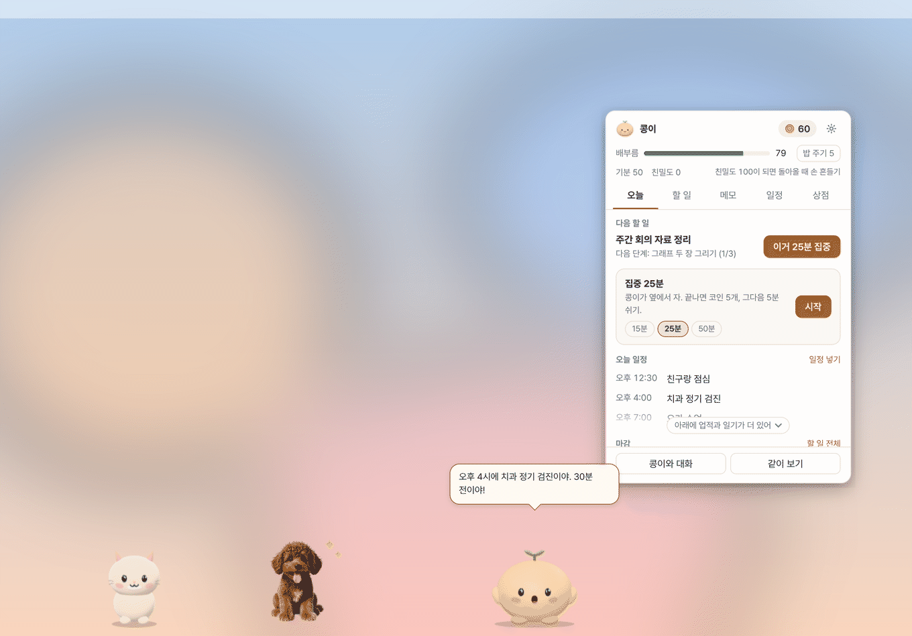
</p>

> 이 문서의 화면은 모두 실제 앱을 띄워 찍었어요. 할 일, 일정, 메모는 지어낸 예시예요.

## 한눈에 보기

### 페어리

<p align="center">
  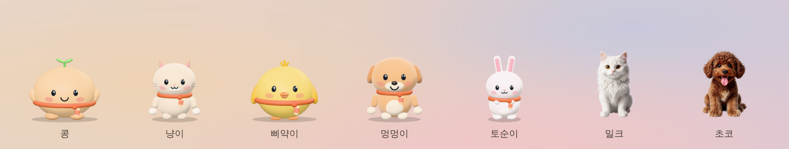
</p>

- 드래그로 옮기고, 잡아서 휙 놓으면 던져져서 통통 튀어요. 좌우로 문지르면 쓰다듬기예요.
- 기본 페어리는 입체(three.js)로 그려요. 모습을 피규어, 게임 캐릭터, 실사, 복슬복슬(시험) 중에 고르거나, 예전처럼 납작한 2D로 둘 수 있어요.
- 기분, 배부름, 친밀도가 있어요. 할 일을 끝내면 코인이 쌓이고, 코인으로 밥과 장난감, 집을 사 줄 수 있어요. 오래 안 놀아 주면 삐지기도 해요.
- 산 집은 페어리 우클릭 메뉴나 집 우클릭 메뉴의 **집 숨기기**로 잠깐 치워 둘 수 있어요. 단계, 모양, 자리는 그대로 남고, 페어리 우클릭 메뉴의 "집 다시 보이기"나 상점의 "집 보이기"로 다시 꺼내요.
- **친구의 페어리 초대하기**로 친구 페어리를 세 마리까지 초대해 같이 돌아다니게 할 수 있어요. 페어리는 `.fairy` 파일로 내보내 친구에게 줄 수 있어요 (예전 `.jjpet` 파일도 그대로 열려요).
- 다른 앱을 전체 화면으로 쓰거나 발표할 때는 가려지고, 단축키로 잠깐 숨길 수도 있어요.

<p align="center">
  
</p>

<p align="center">
  
</p>

### 할 일, 메모, 일정

페어리를 누르면 패널이 열려요. 탭은 오늘, 할 일, 메모, 일정, 상점이에요.

<p align="center">
  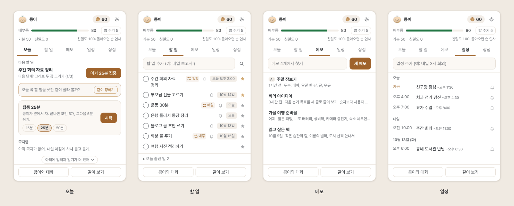
</p>

- **오늘**: 다음 할 일과 그 단계, 바로 시작하는 집중 타이머(15, 25, 50분. 끝내면 코인 3, 5, 10개), 오늘 일정, 마감, 이번 주 기록, 업적, 페어리의 일기.
- **할 일**: 마감일과 시각, 중요 표시, 반복(매일, 평일, 매주, 매달), 단계 체크리스트, 미리 알림(시각이 있으면 기본 하루 전과 1시간 전, 날짜만 있으면 전날 저녁). 끝내면 코인을 받아요.
- **메모**: 찾기, AI가 대화 중에 남긴 메모는 `AI` 표시가 붙어요.
- **일정**: 알림(기본 10분 전), 종일 일정, 알림에서 화상 회의 주소 바로 열기. 구글 캘린더 같은 캘린더의 `.ics` 비공개 주소를 넣으면 30분마다 앞으로 60일 일정을 가져와요.
- **달력**: 일정 탭에서 목록과 달력을 골라요. 월 보기와 주 보기에 일정, 가져온 일정, 마감 있는 할 일, 반복 할 일의 다음 회차가 같이 보이고, 날짜를 누르면 그날 목록이 나오고 바로 그날에 넣을 수 있어요. 한국어에서는 공휴일이 빨간 날로 보여요.
- **고정**: 메모, 할 일, 일정은 핀 단추(줄에 마우스를 올리면 보여요)나 우클릭으로 목록 맨 위에 고정해요. 일정은 목록 맨 위 "고정" 칸에 모이고, 달력과 오늘 탭은 날짜 순서 그대로 핀만 보여요.
- **빠른 입력**: 어디서든 단축키 한 번으로 한 줄 입력 창이 떠요. "내일 3시 회의", "매일 운동", "금요일 휴가"처럼 써요(한국어와 영어).

<p align="center">
  
</p>

어두운 모드도 운영체제 설정을 따라가요.

<p align="center">
  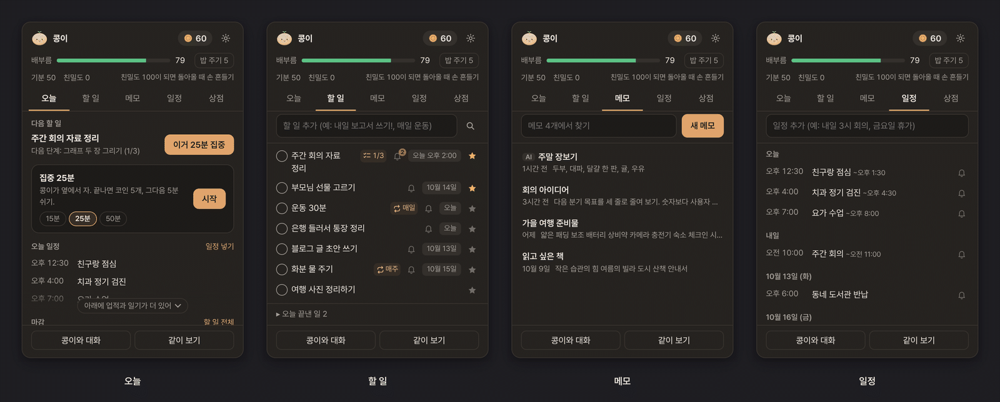
</p>

### 비서와 대화

<p align="center">
  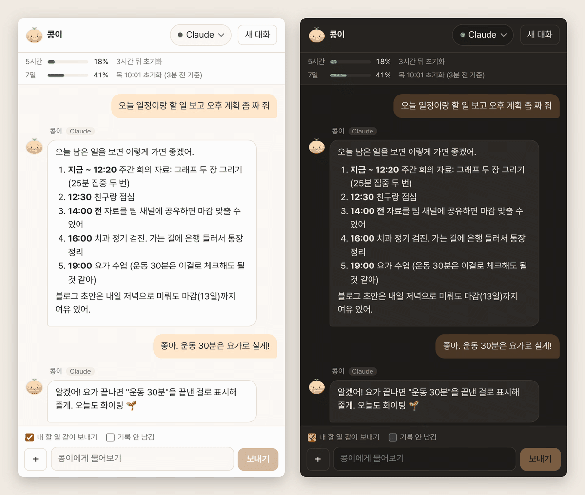
</p>

- 고를 수 있는 AI: Claude Code(`claude`), Codex(`codex`), Cursor(`cursor-agent`, 실험적), Gemini(`gemini`, 실험적), 직접 추가한 CLI, 무료 AI(Qwen3 1.7B 또는 0.6B, 이 컴퓨터 안에서만 돌아요).
- **내 할 일 같이 보내기**를 켜면 "오늘 뭐부터 할까?"에 내 할 일과 일정을 보고 답해요.
- **페어리 도구 쓰기**를 켜면 대화 중에 "내일 장보기 할 일로 넣어 줘"라고 하면 AI가 페어리에 직접 넣어요(Claude, Codex). 지우기, 고치기, 메모 덧붙이기는 페어리가 말풍선으로 먼저 물어보고 "해 줘"를 눌러야 해요.
- **같이 보기**: 페어리를 우클릭해 "같이 보기"를 고르고 화면 일부를 고르면, 그 그림을 AI에게 보여 주며 물어볼 수 있어요.
- 성격과 말투(다정한 친구, 존댓말 비서, 츤데레, 차분한 선생님, 활발한 응원단, 느긋한 고양이, 신난 강아지, 사극 선비, 아나운서). 설정 → AI → 말투에서 말 높이, 말끝, 나를 부르는 말, 자주 하는 말까지 정해 **내 말투**를 만들 수도 있어요. 페어리 규칙, AI 사용량 보기, 내 MCP 도구.
- 반대로 Claude Code나 Codex 안에서 페어리를 MCP 서버로 연결해 "이거 페어리 할 일에 넣어 줘"라고 할 수도 있어요.

<p align="center">
  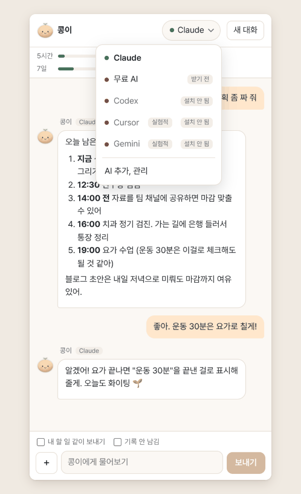
</p>

### 내 페어리 만들기

사진 한 장으로 페어리를 만들어요. 배경 지우기는 이 컴퓨터 안에서 해요.

<p align="center">
  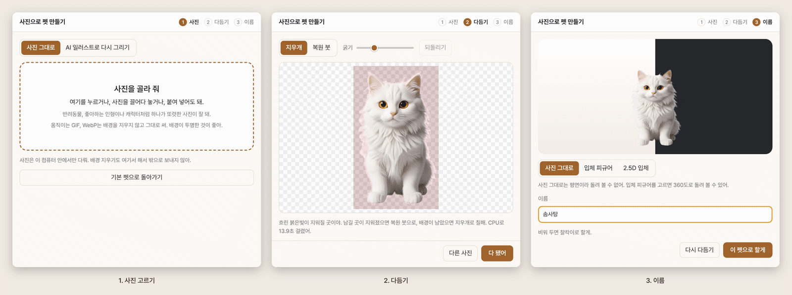
</p>

마지막 단계에서 모습을 골라요.

- **사진 그대로**: 오린 사진을 그대로 써요.
- **입체 피규어**: Claude나 Codex가 사진을 보고 입체 설계도를 그려 360도로 돌려 볼 수 있는 피규어를 만들어요. 다듬은 사진 한 장만 보내고 AI 사용량을 조금 써요.
- **2.5D 입체**: 사진의 깊이를 재서 살짝 입체감 있게 움직여요(깊이 모델은 이 컴퓨터에서 돌아요).

<p align="center">
  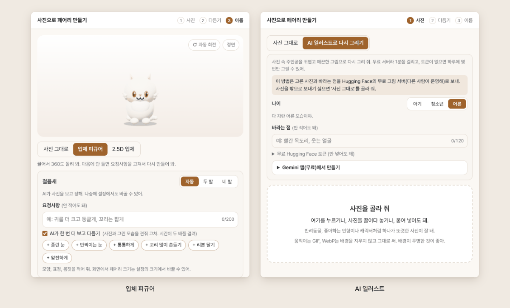
</p>

사진을 귀여운 그림으로 다시 그리고 싶다면 **AI 일러스트로 다시 그리기**를 골라요. 그리는 곳은 셋이에요.

| 그리는 곳 | 횟수 | 사진이 나가는 곳 |
| --- | --- | --- |
| 무료 서버 (기본) | 하루 몇 번. 횟수는 인터넷 연결마다 따로 세고 하루가 지나면 다시 채워져요. 무료 Hugging Face 토큰을 넣으면 더 그릴 수 있어요 | Hugging Face의 무료 그림 서버(다른 사람이 운영) |
| Gemini 앱에서 만들기 | Gemini 앱의 무료 사용량만큼 | 내가 직접 Gemini(구글)에 올려요. 페어리 앱은 보내지 않아요 |
| 내 컴퓨터에서 | 제한 없음. 처음 한 번 준비가 필요해요 | 나가지 않아요 |

- **Gemini 앱(무료)에서 만들기**: 단추를 누르면 요청문이 복사되고 Gemini가 열려요. 고른 사진과 요청문을 보내고, 나온 그림을 페어리 만들기 창에 끌어다 놓으면 이어서 만들어요. 구글 계정만 있으면 돼요.
- **내 컴퓨터에서 그리기**: Apple 칩 Mac(macOS 14 이상)은 mflux로, 윈도우 x64와 인텔 Mac, macOS 12~13 Apple 칩 Mac은 sd.cpp로 그려요. 메모리 8GB 이상이 필요하고, 처음 한 번 mflux는 약 16GB를 받아 약 5GB를 남기고, sd.cpp는 약 5.2GB를 받아요. 그래픽 칩 없이 CPU로 그리면 한 장에 꽤 오래 걸려요.
- **Hugging Face 토큰**: huggingface.co/settings/tokens에서 무료로 만들 수 있어요. 토큰은 그림 서버에도 같이 가니 권한을 가장 적게 준 Fine-grained 토큰을 추천해요. 이 컴퓨터에만 저장하고(운영체제 열쇠로 암호화할 수 있으면 암호화) 백업에도 넣지 않아요.

<p align="center">
  
</p>

### 더 챙겨 주는 것

- **오늘 뭐부터?**: 채팅에 "오늘 뭐부터 할까?" 라고 물으면 AI 없이도 할 일 순서와 집중할 빈 시간을 알려 줘요. 페어리 우클릭 메뉴 "오늘 뭐부터?" 도 같아요.
- **습관**: 반복 할 일을 날마다 체크하고 최근 12주를 잔디로 봐요. 끊겨도 벌은 없어요.
- **아침 계획**: AI 없이도 꼭 할 일 셋과 일정 사이 집중 시간을 같이 정해요.
- **알림 미루기**: 알림에서 10분, 1시간, 내일 아침으로 미루고, 빠른 입력에 "30분 뒤 알려 줘"라고 써도 돼요.
- **페어리가 아는 것**: 페어리가 기억하는 것을 보고 고치고 잊게 할 수 있어요. 생일과 좋아하는 것을 알려 주면 AI 없이도 챙겨 줘요.
- **자라는 페어리와 철마다 옷**: 기본 페어리가 함께한 날만큼 자라고, 계절과 명절마다 옷을 입어요 (설정 → 페어리에서 끄기).
- **주간 카드**: 이번 주 기록을 귀여운 카드 그림으로 저장해요.
- **내보내기**: 메모는 .md, 할 일은 .csv, 일정은 .ics 로 (설정 → 데이터).
- **페어리 갤러리와 페어리 파일**: 설정 → 페어리 → 페어리 갤러리에서 공식 페어리를 데려오고, 페어리는 .fairy 파일로 친구와 주고받아요 ([형식](docs/pet-format.md)).
- **다른 앱에서 부르기**: `fairy://add?text=내일 3시 회의` 같은 주소로 단축어, Raycast, Alfred 에서 할 일을 넣어요 ([연결 안내](docs/integrations.md)).
- **배터리일 때 움직임 줄이기**: 켜기(기본) / 끄기 / 항상 줄이기를 설정 → 편의나 페어리 우클릭 메뉴에서 골라요.
- **접근성**: 말풍선 읽어 주기, 키보드로 페어리 다루기, 운영체제의 움직임 줄이기 설정 따르기.

### 설정

설정은 페어리, 비서, AI, 편의, 데이터, 정보 여섯 탭이고, 맨 위 찾기 칸으로 바로 찾을 수 있어요.

<p align="center">
  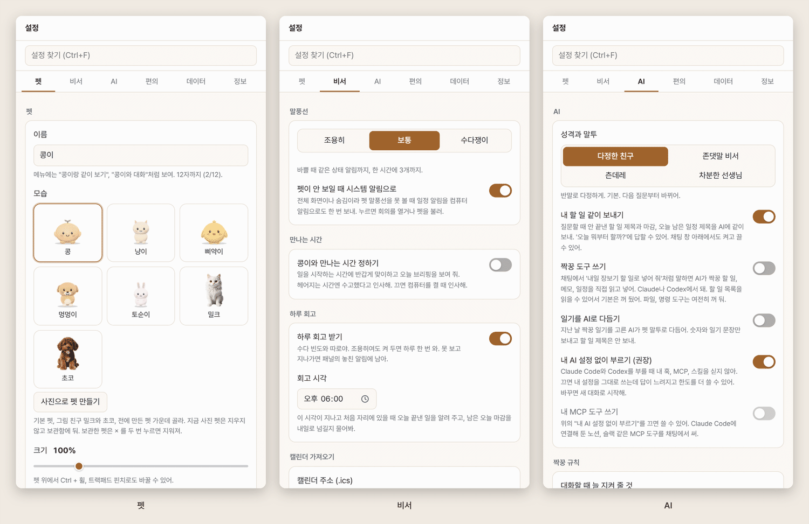
</p>

<p align="center">
  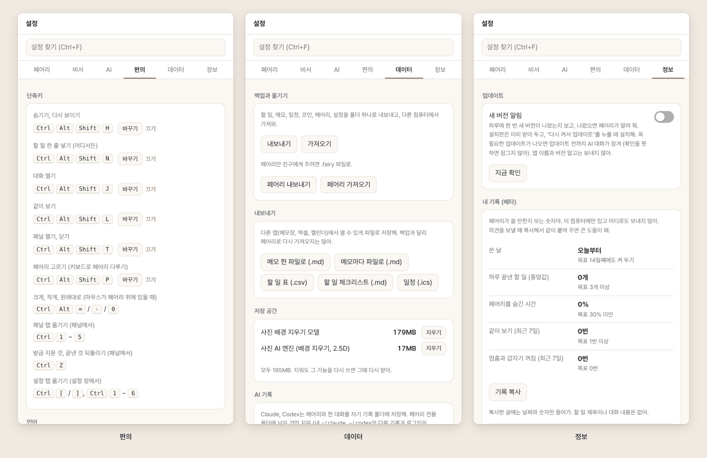
</p>

## 설치

설치 파일은 공개 레포 **[fairy-releases 의 Releases](https://github.com/milcho0604/fairy-releases/releases/latest)** 에 있어요. 받을 파일과 처음 열 때 경고 넘기는 법은 **[설치 안내](docs/install.md)** 에 있어요. 짧게 정리하면 이래요.

- **맥**: 애플 실리콘은 `fairy-<버전>-mac-arm64.dmg`, 인텔은 `fairy-<버전>-mac-x64.dmg`. 아직 애플 개발자 서명 전이라 처음 한 번 시스템 설정 → 개인정보 보호 및 보안에서 "그래도 열기"를 눌러야 해요.
- **윈도우**: `fairy-<버전>-win-x64.exe`. "Windows의 PC 보호" 창이 뜨면 추가 정보 → 실행. 관리자 권한 없이 설치돼요. 윈도우는 아직 확인 중이에요([체크리스트](docs/tests/windows.md)).
- **리눅스(시험판)**: `fairy-<버전>-linux-x64.tar.xz`(풀어서 `fairy` 실행) 또는 `fairy-<버전>-linux-x86_64.AppImage`(실행 권한을 주고 실행).
- 새 버전 확인, AI 모델 목록, 페어리 갤러리는 공개 레포 `milcho0604/fairy-releases` 의 릴리스와 `catalog/models.json`, `gallery/` 를 읽어요(이 소스 레포는 읽지 않아요). 레포가 공개되어 있지 않거나 연결이 안 되면 확인만 조용히 건너뛰고, 모델 목록은 앱에 들어 있는 것을 써요.
- 맥과 윈도우 설치판은 새 버전을 미리 받아 두고 페어리가 "다시 켜서 업데이트"를 띄워요. 누를 때만 설치해요. 리눅스는 페어리가 릴리스 페이지를 열어 줘요.
- 꼭 필요한 업데이트가 나오면 업데이트하기 전까지 AI 대화가 잠겨요(확인을 못 하면 잠그지 않아요). 설정 → 정보 → "새 버전 알림"을 끄면 새 버전 말풍선만 쉬고, 꼭 필요한 업데이트 확인은 계속해요.

### 시스템 요구 사항과 크기

| | 내용 |
| --- | --- |
| 운영체제 | macOS 12 이상(애플 실리콘, 인텔), Windows 10 이상 x64, 리눅스 x64(시험판) |
| AI 대화 | Claude Code, Codex, Cursor, Gemini CLI 중 하나를 설치하고 로그인해 두거나, 무료 AI 모델(Qwen3 1.7B 약 940MB, 0.6B 약 400MB)을 받아요 |
| 설치 파일 크기 | 리눅스 0.1.0 실측(2026-10-11): `tar.xz` 약 86MB, `AppImage` 약 100MB, 풀면 약 294MB. 맥과 윈도우 설치 파일은 릴리스 페이지에 크기가 보여요. 무료 AI 를 처음 쓸 때 엔진(5~11MB)을 모델과 함께 한 번 받아요 |
| 처음 쓸 때 받는 것 | 사진 페어리 배경 지우기 모델 약 170MB와 사진 AI 엔진 약 17MB, 2.5D 깊이 모델 약 27MB(쓸 때만) |
| 내 컴퓨터에서 그리기 | 메모리 8GB 이상, 빈 공간 7~20GB (엔진에 따라. sd.cpp 는 약 5.2GB, mflux 는 약 16GB를 받아요) |

받은 모델은 설정 → 데이터 → 저장 공간에서 크기를 보고 지울 수 있어요.

## 처음 켜기

처음 켜면 네 쪽짜리 안내가 떠요. 페어리 이름과 모습을 고르고, 만나는 시간을 정하고, 같이 보기 권한과 AI 연결을 확인하고, 알아 두면 좋은 조작을 봐요. 언제든 건너뛸 수 있고 나중에 설정에서 다 바꿀 수 있어요.

<p align="center">
  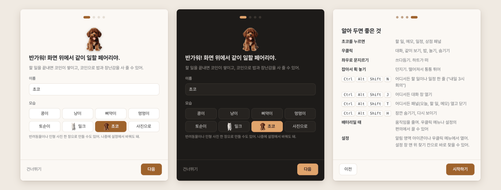
</p>

자세한 사용법은 **[사용 가이드](docs/guide.md)** 에 단계별로 정리해 뒀어요.

## 단축키

맥은 `Cmd`, `Option`, 윈도우는 `Ctrl`, `Alt` 예요. 어디서나 쓰는 여섯 개는 설정 → 편의에서 바꾸거나 끌 수 있어요.

| 어디서 | 키 | 하는 일 |
| --- | --- | --- |
| 어디서나 | `Cmd/Ctrl + Option/Alt + Shift + N` | 빠른 입력 (할 일이나 일정 한 줄) |
| 어디서나 | `Cmd/Ctrl + Option/Alt + Shift + J` | 대화 창 열기 |
| 어디서나 | `Cmd/Ctrl + Option/Alt + Shift + L` | 같이 보기 |
| 어디서나 | `Cmd/Ctrl + Option/Alt + Shift + T` | 패널 열고 닫기 |
| 어디서나 | `Cmd/Ctrl + Option/Alt + Shift + H` | 페어리 숨기기, 다시 보이기 |
| 어디서나 | `Cmd/Ctrl + Option/Alt + Shift + P` | 페어리 고르기 (키보드로 다루기: Enter 패널, 메뉴 키 우클릭 메뉴, 화살표 걷기, Esc 그만) |
| 마우스가 페어리 위에 있을 때 | `Cmd/Ctrl + Option/Alt + =` / `-` / `0` | 페어리 크게, 작게, 원래대로 |
| 마우스가 페어리 위에 있을 때 | `Cmd/Ctrl + 휠`, 트랙패드 핀치 | 페어리 크기 |
| 패널 | `Cmd/Ctrl + 1` ~ `5` | 오늘, 할 일, 메모, 일정, 상점 |
| 패널 | `Cmd/Ctrl + Z` | 방금 지운 것, 끝낸 것 되돌리기 |
| 패널, 빠른 입력 | `Esc` | 입력칸 비우기, 창 닫기 |
| 채팅 | `Enter` / `Shift + Enter` | 보내기 / 줄 바꾸기 |
| 채팅 | `Esc` | 답 멈추기 |
| 채팅 | `Cmd/Ctrl + N` | 새 대화 |
| 채팅 | `↑` | 마지막 질문 다시 불러오기 |
| 설정 | `Cmd/Ctrl + F` | 설정 찾기 |
| 설정 | `Cmd/Ctrl + [` / `]`, `Cmd/Ctrl + 1` ~ `6` | 탭 옮기기 |
| 시작 안내 | `←` / `→` | 이전, 다음 쪽 |

## 개인정보: 무엇이 나가고 무엇이 남나요

페어리 앱 자체는 서버가 없어요. 할 일, 메모, 일정, 코인, 페어리, 설정은 모두 이 컴퓨터의 사용자 데이터 폴더에 있어요.

**이 컴퓨터에만 남는 것**

- 할 일, 메모, 일정, 일기, 코인과 페어리 상태, 페어리가 기억하는 것과 페어리 규칙 (`jjakkung.db`, `settings.json` 등)
- 채팅 창의 최근 대화 40개 (`chat-history.json`, 붙인 그림은 빼고)
- 사진 페어리 만들기의 배경 지우기와 2.5D 깊이 재기, 무료 AI 대화, 내 컴퓨터에서 그리기
- 구글 캘린더 연결 토큰과 Hugging Face 토큰 (운영체제 열쇠로 암호화할 수 있으면 암호화해요)
- 내 기록(쓴 날, 끝낸 할 일 수 같은 숫자)과 진단 기록(`logs/main.log`). 질문, 답, 할 일과 일정 제목은 진단 기록에 남기지 않아요. 의견 보내기에 붙일 때도 경로, 주소, 토큰, 전화번호 같은 것을 한 번 더 가리고, 내가 복사해서 직접 보내요

**같이 보기 화면과 AI 프로그램의 기록**

- 같이 보기로 찍은 화면은 페어리가 디스크에 저장하지 않아요(Codex에 넘길 때만 잠깐 임시 파일로 두고 바로 지워요).
- 화면이나 그림을 실은 질문은 Claude Code와 Codex가 자기 대화 기록에도 남기지 않게 불러요. 보낸 그림은 그 AI 회사의 보관 정책을 따라요.
- 그 밖의 대화는 Claude Code가 `~/.claude/projects/` 안의 페어리 전용 폴더에, Codex는 페어리 데이터 폴더의 `codex-home/`에 이어가기용 기록을 남겨요. 채팅 창의 **기록 안 남김**을 켜면 남기지 않고, 설정 → 데이터 → **AI 기록 지우기**로 페어리 것만 지울 수 있어요(내 다른 Claude, Codex 기록과 로그인은 그대로).

**같이 타자 치기와 매일 쪽지**

같이 타자 치기는 어떤 키를 눌렀는지 읽지 않아요. 운영체제가 알려 주는 '마지막 입력 뒤 지난 시간'과 커서 위치만 1초에 두 번까지 보고, 아무것도 저장하거나 보내지 않아요. 매일 쪽지는 이 컴퓨터의 기록으로만 쓰고 AI를 부르지 않아요. AI가 페어리 도구(MCP)를 부르면 데이터 폴더의 빈 파일 `mcp-beat` 의 시각만 바뀌어요(페어리가 같이 일하는 표정을 짓는 데 써요).

**밖으로 나가는 것 (내가 그 기능을 쓸 때만)**

| 기능 | 어디로 | 무엇이 |
| --- | --- | --- |
| AI 대화, 같이 보기 | 내가 고른 AI CLI가 연결된 곳 (Anthropic, OpenAI, Cursor, Google) | 질문, 고른 화면 그림. 질문마다 페어리 이름과 성격, 페어리 규칙, 내가 허락한 "페어리가 기억하는 것"이 같이 가요. "내 할 일 같이 보내기"를 켜면 안 끝낸 할 일 제목과 마감, 오늘 남은 일정 제목 |
| 메모 요약, 다듬기, 할 일로 쪼개기 | 내가 고른 AI | 그 메모 글(고른 부분만 고르면 그 부분) |
| 일기를 AI로 다듬기 (설정 → AI) | 내가 고른 AI | 그날 숫자(끝낸 할 일 수 등)와 페어리가 쓴 일기 문장. 할 일 제목은 보내지 않아요 |
| 입체 피규어 만들기 | Claude 또는 Codex | 다듬은 사진 한 장 |
| AI 일러스트 (무료 서버) | Hugging Face의 무료 그림 서버 | 고른 사진, 바라는 점, 넣었다면 HF 토큰 |
| 캘린더 가져오기 | 내가 넣은 `.ics` 주소 | 요청만 (받아 오기) |
| 구글 캘린더로 보내기 | 구글 캘린더 API (내가 연결했을 때만) | 페어리에서 넣은 일정의 제목, 시각, 알림 |
| 모델과 도구 받기 | GitHub, Hugging Face, jsDelivr/unpkg, PyPI 등 | 요청만 (받아 오기) |
| 업데이트 확인, 모델 목록, 갤러리 | GitHub (`milcho0604/fairy-releases` 릴리스와 `catalog/models.json`, `gallery/`) | 요청만 (앱 이름과 버전) |

Claude Code와 Codex는 기본으로 내 훅, MCP, 스킬을 싣지 않고 불러요(설정 → AI → "내 AI 설정 없이 부르기").

## 백업과 옮기기

설정 → 데이터 → **백업과 옮기기**에서 할 일, 메모, 일정, 코인, 페어리, 설정을 폴더 하나로 내보내고, 다른 컴퓨터에서 가져올 수 있어요. 받은 모델과 내 컴퓨터에서 그리기 도구는 크기가 커서 넣지 않아요(다른 컴퓨터에서 다시 받으면 돼요). 페어리 하나만 친구에게 줄 때는 **페어리 내보내기**로 `.fairy` 파일을 만들어요.

앱을 지워도 데이터는 남아요. 완전히 지우는 법(데이터 폴더와 AI 프로그램 기록 위치)은 [설치 안내의 지우기](docs/install.md#지우기)에 있어요.

## 자주 묻는 질문

**AI 프로그램이 하나도 없어도 쓸 수 있나요?**
네. 페어리, 할 일, 메모, 일정은 AI 없이 다 돼요. 대화는 채팅 창의 AI 고르기에서 "무료 AI"를 고르면 처음 한 번 모델을 받고 이 컴퓨터 안에서만 돌아요.

**채팅 창에 "설치 안 됨"이라고 나와요.**
페어리 앱은 AI를 직접 갖고 있지 않고, 터미널에서 쓰는 AI 프로그램(CLI)을 불러요. 그 프로그램을 설치하고 로그인한 뒤 페어리를 다시 켜 보세요. 목록에 없는 CLI는 "AI 추가, 관리"에서 직접 넣을 수 있어요.

**맥에서 같이 보기가 안 돼요.**
시스템 설정 → 개인정보 보호 및 보안 → 화면 및 시스템 오디오 녹음에서 fairy를 켜고 페어리를 다시 켜야 해요. 자세한 건 [설치 안내](docs/install.md#같이-보기-권한-화면-기록)에 있어요.

**페어리가 작업을 가려요.**
페어리 위에서 휠을 그냥 굴리면 아래 창으로 넘어가요. 단축키로 잠깐 숨기거나, 설정 → 페어리에서 "가끔 돌아다니기"를 끄고 크기를 줄여 보세요. 발표나 화면 공유 중에는 저절로 숨어요.

**무료 그림 횟수가 끝났대요.**
다음 날 다시 채워져요. 지금 바로 만들려면 "Gemini 앱(무료)에서 만들기"를 쓰거나, 무료 Hugging Face 토큰을 넣거나, 되는 컴퓨터라면 "내 컴퓨터에서 그리기"를 골라요.

**리눅스에서도 되나요?**
시험판이에요. 릴리스에 `tar.xz` 와 `AppImage` 를 올리고, 켜지는지는 CI 에서 매번 확인해요. 자동 업데이트는 없고 새 버전이 나오면 페어리가 릴리스 페이지를 열어 줘요. 같이 보기와 창 위에 올라앉기는 데스크톱 환경(X11, Wayland)에 따라 다를 수 있어요.

**문제를 알리고 싶어요.**
메뉴 막대(윈도우는 작업 표시줄 오른쪽 아래)의 페어리 아이콘 → **의견 보내기**. 설정 → 정보의 "기록 복사"로 숫자만 담긴 기록을 같이 붙일 수 있어요.

## 개발

Node 24를 권해요(`.nvmrc`, 최소 22.18. 시험이 TypeScript 파일을 그대로 돌려요). 기여 방법은 [CONTRIBUTING.md](CONTRIBUTING.md), 보안 문제 알리기는 [SECURITY.md](SECURITY.md)를 봐 주세요. 앱 버그는 [fairy-releases 의 이슈](https://github.com/milcho0604/fairy-releases/issues)로 받아요.

```bash
npm install
npm run dev        # 앱을 띄우고 화면 코드를 고치면 바로 반영
npm run check      # 타입 검사 + 린트 + 시험
npm test           # 시험만 (node --test "src/**/*.test.ts")
npm run typecheck  # 타입 검사만
npm run lint       # biome 검사 (고치려면 npm run format)
npm run build      # out/ 에 빌드
npm run dist       # 지금 컴퓨터용 설치 파일 (dist/)
npm run dist:mac   # 맥 dmg (애플 실리콘과 인텔)
npm run dist:win   # 윈도우 설치 파일. 릴리스는 GitHub Actions 의 release.yml
npm run dist:linux # 리눅스 tar.xz, AppImage
```

| 폴더 | 내용 |
| --- | --- |
| `src/main/` | Electron 메인 프로세스 (창, 트레이, DB, AI 실행, MCP 서버) |
| `src/preload/` | 화면에 열어 줄 기능만 모아 둔 다리 |
| `src/renderer/` | 화면. 페어리 창은 가볍게 React 없이, 패널과 채팅, 설정, 페어리 만들기는 React |
| `src/shared/` | 화면과 메인이 같이 쓰는 순수 로직, 번역(`i18n/`), 시험 |
| `scripts/` | 빌드 보조, 개발 점검 도구(`scripts/dev/`) |
| `catalog/` | 앱이 하루 한 번 받아 보는 AI 모델 목록 |
| `spike/` | 0단계 실험 앱 |

실제 앱을 띄워 상태를 넣고 화면을 찍어 보는 도구는 [scripts/dev/README.md](scripts/dev/README.md)에 있어요. 테스트용으로 띄울 때는 늘 `JJ_NO_FOCUS=1`과 빈 `JJ_USER_DATA` 폴더를 써요.

| 문서 | 내용 |
| --- | --- |
| [docs/guide.md](docs/guide.md) | 사용 가이드 |
| [docs/install.md](docs/install.md) | 설치 안내 (맥, 윈도우, AI 연결, 지우기) |
| [docs/google-calendar.md](docs/google-calendar.md) | 구글 캘린더 쓰기 연결 (OAuth 클라이언트 등록) |
| [docs/release.md](docs/release.md) | 릴리스 올리기, 자동 업데이트, 서명 |
| [docs/roadmap.md](docs/roadmap.md) | 진행표 |
| [docs/plan.md](docs/plan.md) | 기획서 (html 판은 `python3 scripts/build_plan_html.py` 로 다시 만들어요) |
| [docs/tests/](docs/tests/) | 확인 시나리오 (AI CLI, 배경 지우기, 윈도우) |
| [CHANGELOG.md](CHANGELOG.md) | 변경 이력 |

## 라이선스

[MIT](LICENSE) © 2026 milcho0604

배경 지우기 모델(IS-Net), 무료 AI 모델(Qwen3, Apache-2.0), 그림 모델 같은 받아 쓰는 모델은 각자의 라이선스를 따라요.

---

## English summary

**fairy** (페어리, formerly Jjakkung) is a desktop app for macOS 12+ and Windows 10+ (Linux x64 builds are experimental) where a little fairy, a small creature like a puppy or a kitten, lives on your screen and doubles as a personal assistant. Site: [fairy.moilga.com](https://fairy.moilga.com).

- **Fairy**: five built-in 3D fairies (Bean, Kitty, Chick, Puppy, Bunny) plus two illustrated ones (Milk, Choco). Drag, throw, pet it, feed it with coins earned from finished to-dos, or make your own fairy from a photo (background removal runs locally; optional 3D figure, 2.5D depth, or AI illustration via a free Hugging Face Space, the Gemini app, or on-device drawing).
- **Assistant**: click the fairy for a panel with Today, To-dos, Notes, Events and Shop. Natural-language quick add ("meeting tomorrow 3pm", Korean and English), repeating to-dos, reminders, a focus timer, daily review, `.ics` calendar import.
- **AI**: chat through the AI CLIs you already have (Claude Code, Codex, Cursor, Gemini) or a free local model (Qwen3). "Look together" sends a selected screen area to your AI. Fairy also runs as an MCP server so Claude Code or Codex can add to-dos, notes and events.
- **Privacy**: no fairy server. Your data stays on your computer; things leave only when you use a feature that needs it (your chosen AI, the free illustration server, calendar URLs, downloads, update checks). Questions that carry a screenshot are never saved in the AI CLI's own history, and Settings → Data → Clear AI history removes what Claude Code and Codex kept for fairy. Deletes and edits the chat AI asks for need your OK in the fairy's bubble.
- **Updates**: update checks, the model catalog and the fairy gallery read the public repository [milcho0604/fairy-releases](https://github.com/milcho0604/fairy-releases) (its releases, `catalog/models.json` and `gallery/`), never this source repository; when offline, the check is skipped and the built-in catalog is used. Turning off new version notices only silences the bubble; required updates are still checked, and AI chat stays locked until you install one.
- **Install**: download from [fairy-releases Releases](https://github.com/milcho0604/fairy-releases/releases/latest); details in [docs/install.md](docs/install.md) (Korean). Bugs go to [fairy-releases issues](https://github.com/milcho0604/fairy-releases/issues). Builds are not yet signed by Apple or Microsoft, so allow the app once on first launch.
- **Develop**: Node 24 (`.nvmrc`, 22.18+ works), `npm install`, `npm run dev`, `npm run check`. See [CONTRIBUTING.md](CONTRIBUTING.md) and [SECURITY.md](SECURITY.md).
- **License**: MIT.
