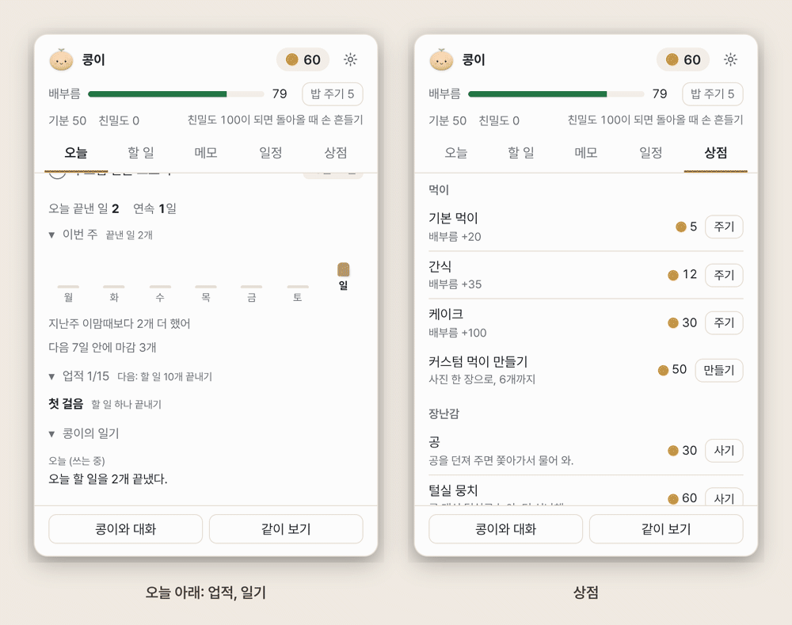

# 페어리 사용 가이드

페어리를 처음 켜는 것부터 페어리와 놀기, 할 일과 일정 챙기기, AI와 대화하기, 내 페어리 만들기까지 차례로 정리했어요. 설치는 [설치 안내](install.md)를 먼저 봐 주세요.

> 화면은 모두 실제 앱에서 찍었고, 할 일, 일정, 메모는 지어낸 예시예요. 단축키는 맥 기준 `Cmd`, `Option`이고 윈도우는 `Ctrl`, `Alt`예요. 화면 속 키 이름은 찍은 컴퓨터에 따라 `Ctrl`로 보일 수 있어요.

**차례**

1. [처음 켜기](#1-처음-켜기)
2. [페어리와 놀기](#2-페어리와-놀기)
3. [할 일, 메모, 일정](#3-할-일-메모-일정)
4. [비서와 대화](#4-비서와-대화)
5. [내 페어리 만들기](#5-내-페어리-만들기)
6. [설정](#6-설정)
7. [백업과 옮기기](#7-백업과-옮기기)
8. [문제 해결](#8-문제-해결)

---

## 1. 처음 켜기

설치하고 처음 열면 네 쪽짜리 시작 안내가 떠요. `←` `→` 키로도 넘길 수 있고, **건너뛰기**를 눌러도 나중에 설정에서 다 바꿀 수 있어요.

1. **이름과 모습**: 페어리 이름(12자까지)을 짓고 모습을 골라요. 기본 페어리 다섯(콩, 냥이, 삐약이, 멍멍이, 토순이), 그림 친구 둘(밀크, 초코), 또는 **사진으로** 직접 만들기.
2. **만나는 시간**: 일을 시작하는 요일과 시간을 정하면 그때 반갑게 맞이하며 오늘 할 일을 알려 주고, 끝날 땐 수고했다고 인사해요. 정하지 않으면 켤 때마다 인사해요.
3. **같이 보기**: 맥은 화면 기록 권한이 필요해요. "시스템 설정 열기"를 누르고 fairy를 켠 뒤 페어리를 다시 켜요. 같이 보기를 안 쓸 거면 넘어가도 돼요. 이 쪽에서 AI 연결 상태도 같이 알려 줘요.
4. **알아 두면 좋은 것**: 누르기, 우클릭, 문지르기, 던지기, 단축키를 한 장에 모아 뒀어요.

**시작하기**를 누르면 화면 아래쪽에 페어리가 나타나요. 메뉴 막대(윈도우는 작업 표시줄 오른쪽 아래 알림 영역)에도 페어리 아이콘이 생겨요. 페어리는 Dock에 뜨지 않아요.

## 2. 페어리와 놀기

### 만지기

| 하는 것 | 페어리는 |
| --- | --- |
| 누르기 | 패널(오늘, 할 일, 메모, 일정, 상점)을 열고 닫아요 |
| 우클릭 | 메뉴: 같이 보기, 대화, 할 일 추가, 밥 주기, 놀기, 집중 시작, 말풍선, 숨기기, 사진으로 페어리 만들기, 설정, 새로고침, 끝내기 |
| 끌기 | 원하는 곳으로 옮겨요. 놓은 자리를 기억해요 |
| 잡아서 휙 놓기 | 던져져서 떨어지고 통통 튀어요 |
| 좌우로 문지르기 | 쓰다듬기. 하트가 떠요 |
| 페어리 위에서 `Cmd + 휠`, 트랙패드 핀치 | 크기 바꾸기 (`Cmd + Option + =` / `-` / `0` 도 돼요) |

### 페어리의 하루

- **돌아다니기**: 가만히 있다가 가끔 걷고, 창 위에 올라앉기도 해요. 한가할 때 마우스가 가까이 오면 그쪽을 봐요. 둘 다 설정 → 페어리에서 끌 수 있어요.
- **하루 리듬**: 아침엔 잠이 덜 깨고 낮엔 활발하고 밤엔 졸려요. 쉬지 않고 오래 일하면 같이 지쳐요. 자리를 비우면 졸다가 잠들어요.
- **배부름과 밥**: 시간이 지나면 배가 고파요. 패널 위쪽 **밥 주기**나 우클릭 → 밥 주기로 코인을 써서 먹여요. 상점에서 간식, 케이크도 살 수 있고, 사진 한 장으로 커스텀 먹이도 만들 수 있어요.
- **코인**: 할 일을 끝내면 코인을 받아요. 집중 타이머를 끝까지 해도 받아요.
- **놀기**: 우클릭 → 놀기에서 산책(5분), 숨바꼭질, 공 던져 주기(상점에서 공을 사면). 상점에서 장난감과 집도 살 수 있어요.
- **기분과 삐짐**: 오래 안 놀아 주거나 밥이 늦거나 할 일을 미루면 고개를 돌려요. 쓰다듬기, 밥, 놀기로 풀리고, 가만둬도 두 시간 안에 풀려요. 잃는 건 없어요. 설정 → 페어리에서 쉬는 날(이날은 안 와도 안 삐져요)과 "매운맛"을 정할 수 있어요.
- **친밀도와 업적**: 친밀도가 오르면 몸짓이 늘어요(100이 되면 돌아올 때 손을 흔들어요). 업적과 연속 기록은 패널 오늘 탭 아래에 있어요.
- **말풍선**: 일정 알림, 마감, 칭찬을 말풍선으로 알려 줘요. 우클릭 → 말풍선에서 조용히, 보통, 수다쟁이를 골라요. 말풍선을 누르면 닫혀요.

### 숨기기

- `Cmd + Option + Shift + H` 로 잠깐 숨기고 다시 보여요.
- 다른 앱을 전체 화면으로 쓰거나 발표할 때는 저절로 가려져요.
- 페어리 위에서 그냥 휠을 굴리면 아래 창으로 스크롤이 넘어가요.

### 모습 바꾸기

설정 → 페어리에서 모습, 크기, 입체 모습(피규어, 게임 캐릭터, 실사, 복슬복슬), 걸음새(자동, 두 발, 네 발)를 바꿔요. "입체로 보기"를 끄면 납작한 2D 그림이에요.

**친구의 페어리 초대하기**에서 친구 페어리를 세 마리까지 초대해요. 같이 돌아다니고 놀지만 할 일과 대화는 기본 페어리가 맡아요.

## 3. 할 일, 메모, 일정

페어리를 누르거나 `Cmd + Option + Shift + T` 로 패널을 열어요. 탭은 `Cmd + 1` ~ `5` 로 옮겨요. 다른 곳을 누르거나 `Esc` 를 누르면 닫혀요.

### 오늘

- **다음 할 일**: 지금 할 만한 일과 그 다음 단계. **이거 25분 집중**을 누르면 바로 집중을 시작해요.
- **집중**: 15, 25, 50분 중에 골라 **시작**. 그동안 페어리는 옆에서 자고, 끝나면 코인(15분 3개, 25분 5개, 50분 10개, 하루 40개까지)과 쉬기(5분, 50분 집중 뒤에는 10분).
- **오늘 일정**, **마감**, **중요**: 오늘 챙길 것을 모아 보여요.
- 아래로 내리면 오늘 끝낸 일과 연속 기록, **이번 주**(요일별 막대와 지난주 비교), **업적**, **페어리의 일기**가 있어요.
- 보지 못하고 지나간 알림은 **놓친 알림**에 남아요.

### 할 일

1. 위 입력칸에 한 줄로 써요. 예: `내일 보고서 쓰기!`(끝의 `!` 는 중요), `매일 운동`, `평일 스탠드업`, `매주 월요일 회의`, `금요일까지 발표 자료`.
2. 줄 오른쪽의 날짜, 종, 별을 눌러 마감일과 시각, 미리 알림, 중요를 고쳐요. 반복(매일, 평일, 매주)도 여기서. 미리 알림은 마감 시각이 있으면 기본 하루 전과 1시간 전, 날짜만 있으면 전날 저녁 8시예요.
3. **단계** 단추를 눌러 작은 단계(체크리스트)를 적고 `Enter` 로 더해요. 오늘 탭의 "다음 단계"가 여기서 와요.
4. 동그라미를 눌러 끝내면 코인을 받아요. 잘못 눌렀으면 `Cmd + Z` 로 되돌려요. 끝낸 일은 아래 **오늘 끝낸 일**에 모여요.
5. 돋보기로 할 일을 찾아요.

### 메모

**새 메모**로 쓰고, 위 칸에서 찾아요. AI가 대화 중에 남긴 메모에는 `AI` 표시가 붙어요.

### 일정

- 입력칸에 `내일 3시 회의`, `금요일 휴가`처럼 써요. 일정마다 **종일**을 켜고 끌 수 있어요.
- 알림은 기본으로 시작 10분 전이고, 종을 눌러 바꿔요. 일정에 화상 회의 주소가 있으면 알림에서 바로 열 수 있어요.
- **캘린더 가져오기**: 설정 → 비서 → 캘린더 가져오기에 구글 캘린더의 "iCal 형식의 비공개 주소"(`.ics`)를 붙여 넣으면 30분마다 앞으로 60일 일정을 가져와요. 이 주소는 이 컴퓨터에만 둬요.
- **구글 캘린더로 보내기**: 페어리에서 넣은 일정을 구글 캘린더에도 넣어요. 이 기능은 OAuth 클라이언트가 들어 있는 빌드에서만 연결 단추가 보여요([구글 캘린더 연결](google-calendar.md)).

### 빠른 입력

어떤 앱을 쓰다가도 `Cmd + Option + Shift + N` 을 누르면 한 줄 입력 창이 떠요. `내일 오후 3시 치과`처럼 시각이 든 줄은 일정으로, 나머지는 할 일로 들어가요(`3시까지 보고서`처럼 "까지"가 붙으면 마감 시각이 있는 할 일). 영어도 돼요(`tomorrow buy milk`, `gym every monday`).

### 습관과 아침 계획

- **습관**: 반복 할 일은 오늘 탭의 습관 칸에서 체크해요. "n일째"와 최근 12주 잔디가 보이고, 끊겨도 "오늘 다시 시작!"만 해요.
- **아침 계획**: 아침에 처음 패널을 열거나 페어리가 "같이 정하기"를 물으면, 꼭 할 일 셋과 일정 사이 집중 시간을 같이 정해요. AI가 있으면 "AI에게 다듬어 달라기"를 눌러 다듬을 수 있어요.
- **알림 미루기**: 알림의 10분, 1시간, 내일 아침 단추로 미뤄요. 리눅스는 알림을 누르면 오늘 탭의 "방금 울린 알림"에서 골라요. 빠른 입력에 "30분 뒤 알려 줘"라고 써도 돼요.

### 하루 회고

설정 → 비서 → 하루 회고를 켜면 정한 시각(기본 오후 6시)에 오늘 끝낸 일을 알려 주고, 남은 일은 내일로 넘길지 물어봐요.

## 4. 비서와 대화

### AI 연결하기

페어리는 AI를 직접 갖고 있지 않고, 이 컴퓨터에 설치해 로그인해 둔 AI 프로그램(CLI)을 불러요.

1. Claude Code(`claude`), Codex(`codex`), Cursor(`cursor-agent`), Gemini(`gemini`) 중 하나를 설치하고 각 안내대로 로그인해요.
2. 페어리 우클릭 → 대화, 또는 `Cmd + Option + Shift + J` 로 채팅 창을 열어요.
3. 위쪽 AI 이름을 눌러 골라요. 초록 점이면 바로 쓸 수 있어요. 목록에 없는 CLI는 **AI 추가, 관리**에서 넣어요.
4. AI 프로그램이 없으면 **무료 AI**를 골라요. 처음 한 번 모델(약 940MB)을 받고, 그 뒤로는 이 컴퓨터 안에서만 돌아요.

### 대화하기

- `Enter` 로 보내고 `Shift + Enter` 로 줄을 바꿔요. `Esc` 는 답 멈추기, `Cmd + N` 은 새 대화, `↑` 는 마지막 질문 다시 불러오기.
- **+** 단추로 그림을 붙여 물어볼 수 있어요(그림을 읽는 AI만).
- **내 할 일 같이 보내기**: 켜면 안 끝낸 할 일 제목과 마감, 오늘 남은 일정 제목을 같이 보내서 "오늘 뭐부터 할까?"에 답할 수 있어요.
- **기록 안 남김**: 켜면 그 대화를 이어 갈 기록을 AI 프로그램 쪽에도 남기지 않아요. 그림이나 화면을 붙인 질문은 이걸 켜지 않아도 늘 남기지 않아요.
- 이어가기용으로 Claude Code, Codex가 남긴 페어리 대화는 설정 → 데이터 → **AI 기록 지우기**로 지울 수 있어요. 내 다른 대화와 로그인은 그대로예요.
- Claude는 위쪽에 사용량(5시간, 7일)을 보여 줘요.

### 같이 보기

페어리 우클릭 → "같이 보기", 또는 `Cmd + Option + Shift + L`. 화면에서 물어볼 곳을 끌어서 고르면 그 그림을 AI에게 보여 주며 물어볼 수 있어요. 찍은 화면은 페어리가 저장하지 않고 고른 AI에게만 보내요. AI 프로그램(Claude Code, Codex)의 대화 기록에도 남기지 않게 불러요.

### AI가 페어리를 쓰게 하기

- **페어리 도구 쓰기**(설정 → AI): 켜면 채팅에서 "내일 장보기 할 일로 넣어 줘"라고 할 때 AI가 할 일, 메모, 일정을 직접 읽고 넣어요(Claude, Codex). 할 일 목록을 읽을 수 있어서 기본은 꺼져 있어요. 할 일이나 일정을 **지우거나 고치는 것**, 메모에 덧붙이는 것은 바로 하지 않고 페어리가 말풍선으로 "AI가 이렇게 바꾸려고 해. 할까?"라고 물어요. **해 줘**를 눌러야 해요(구독한 캘린더 제목이나 화면 속 글이 AI에게 엉뚱한 일을 시키지 못하게).
- **다른 AI에서 페어리 쓰기(MCP)**(설정 → AI): Claude Code나 Codex에 페어리를 MCP 서버로 등록하는 명령과 설정을 복사할 수 있어요. 등록하면 그 안에서 "이거 페어리 할 일에 넣어 줘", "내일 3시 회의 일정 잡아 줘"가 되고, 넣은 것은 몇 초 안에 패널에 보여요.
- **성격과 말투**: 다정한 친구, 존댓말 비서, 츤데레, 차분한 선생님. **페어리 규칙**에 "대화할 때 늘 지켜 줄 것"을 적어 둘 수 있어요.

## 5. 내 페어리 만들기

페어리 우클릭 → **사진으로 페어리 만들기**, 또는 설정 → 페어리 → 사진으로 페어리 만들기.

1. **사진 고르기**: 사진을 누르거나 끌어다 놓거나 붙여 넣어요. 반려동물이나 인형처럼 하나가 또렷한 사진이 잘 돼요. 처음 한 번 배경 지우는 도구(약 195MB)를 받고, 그 뒤 배경 지우기는 이 컴퓨터 안에서 해요.
2. **다듬기**: 흐린 붉은빛이 지워질 곳이에요. 남길 곳이 지워졌으면 **복원 붓**, 배경이 남았으면 **지우개**로 칠해요. 굵기를 바꾸고 **되돌리기**로 한 번씩 물러요. 다 되면 **다 됐어**.
3. **모습과 이름**: 모습을 고르고 이름을 지은 뒤 **이 페어리로 할게**.
   - **사진 그대로**: 오린 사진 그대로.
   - **입체 피규어**: **AI로 입체 만들기**를 누르면 Claude나 Codex가 사진을 보고 입체 모형을 만들어요. 끌어서 360도 돌려 보고, 마음에 안 들면 요청사항(예: "졸린 눈", "리본 달기")을 적어 **다시 만들기**. 걸음새는 AI가 정하거나 직접 골라요.
   - **2.5D 입체**: 사진의 깊이를 재서 살짝 입체감 있게 움직여요.

### AI 일러스트로 다시 그리기

맨 위에서 **AI 일러스트로 다시 그리기**를 고르면 사진 속 주인공을 귀엽고 매끈한 그림으로 다시 그린 뒤 배경을 지우고 2.5D로 만들어요. 나이(아기, 청소년, 어른)와 바라는 점(예: "빨간 목도리")을 적을 수 있어요.

- **무료 서버(기본)**: Hugging Face의 무료 그림 서버로 사진과 바라는 점을 보내요. 1분쯤 걸리고 하루 몇 번 그릴 수 있어요. 횟수는 인터넷 연결마다 따로 세고 하루가 지나면 다시 채워져요.
- **무료 Hugging Face 토큰**: 더 그리고 싶으면 huggingface.co/settings/tokens에서 무료 토큰을 만들어 "무료 Hugging Face 토큰" 칸에 넣어요. 토큰은 그림 서버에도 같이 가니 권한을 가장 적게 준 Fine-grained 토큰을 추천해요. 이 컴퓨터에만 저장해요.
- **내 컴퓨터에서 그리기**: 되는 컴퓨터(메모리 8GB 이상)라면 "그리는 곳"에서 고를 수 있어요. 처음 한 번 **준비하기**로 그림 도구와 모델을 받아요(Apple 칩 Mac은 약 16GB를 받아 약 5GB만 남기고, 그 밖은 약 5.2GB). 준비는 30분쯤 걸릴 수 있고 멈춰도 이어서 받아요. 사진은 이 컴퓨터 밖으로 나가지 않아요.

### Gemini 앱(무료)에서 만들기

무료 서버 횟수가 끝났거나 페어리 앱이 사진을 보내는 게 싫다면, 구글 계정으로 Gemini 앱에서 만들어 가져올 수 있어요.

1. 모양(피규어, 일러스트)을 골라요.
2. **요청문 복사하고 Gemini 열기**를 누르면 요청문이 복사되고 브라우저에 Gemini가 열려요.
3. Gemini에 고른 사진을 올리고, 요청문을 붙여 넣어 보내요.
4. 나온 그림을 저장해서 "Gemini에서 받은 그림을 여기에" 칸에 끌어다 놓거나 붙여 넣어요(`Cmd + V`).
5. 그다음은 사진 그대로처럼 다듬기와 이름 정하기로 이어져요. 오른쪽 아래 반짝이 표시는 바탕이 하야면 알아서 지우고, 남으면 지우개로 지워요.

### 페어리 갤러리와 페어리 파일

공식 페어리는 설정 → 페어리 → 페어리 갤러리에서 데려올 수 있고, 친구에게는 "페어리 파일로 내보내기"로 .fairy 파일을 보내요. 받은 .fairy 파일은 두 번 누르면 가져와요.

### 만든 페어리 관리

- 전에 만든 페어리는 설정 → 페어리의 모습 목록(보관함)에 남아요. 다른 페어리로 바꿔도 지우지 않아요. 보관한 페어리는 × 를 두 번 누르면 지워져요.
- **페어리 내보내기**(설정 → 데이터)로 `.fairy` 파일을 만들어 친구에게 줄 수 있고, 받은 파일은 **페어리 가져오기**나 친구 페어리 칸의 ".fairy 파일로 초대하기"로 넣어요.

## 6. 설정

페어리 우클릭 → 설정, 또는 메뉴 막대 아이콘 → 설정. 탭은 여섯이고 `Cmd + [` `]`, `Cmd + 1` ~ `6` 으로 옮겨요. 맨 위 찾기 칸(`Cmd + F`)에 "단축키", "백업"처럼 쓰면 맞는 칸으로 바로 가요.

| 탭 | 들어 있는 것 |
| --- | --- |
| 페어리 | 이름, 모습, 크기, 입체 모습과 걸음새, 돌아다니기, 마우스 쳐다보기, 하루 리듬, 효과음(기본 끔), 부스트 모드, 알림 영역 컴퓨터 상태, 친구의 페어리 초대하기, 삐짐 |
| 비서 | 말풍선 양, 시스템 알림, 만나는 시간, 하루 회고, 캘린더 가져오기, 구글 캘린더로 보내기 |
| AI | 성격과 말투, 내 할 일 같이 보내기, 페어리 도구 쓰기, 일기를 AI로 다듬기, 내 AI 설정 없이 부르기, 내 MCP 도구, 페어리 규칙, 다른 AI에서 페어리 쓰기(MCP) |
| 편의 | 단축키 바꾸기와 끄기, 언어(자동, 한국어, English), 로그인할 때 켜기 |
| 데이터 | 백업과 옮기기, 페어리 내보내기와 가져오기, 저장 공간(받은 모델과 안전 복사본 크기 보기, 지우기), AI 기록 지우기 |
| 정보 | 새 버전 알림, 내 기록(베타), 오픈소스 라이선스 |

- **단축키 바꾸기**: 편의 탭에서 **바꾸기**를 누르고 새 키를 누르면 돼요. 다른 단축키와 겹치면 알려 줘요. **끄기**로 아예 안 쓸 수도 있어요.
- **부스트 모드**: 사양이 좋은 컴퓨터용이에요. 페어리가 더 부드럽게 움직이고 무료 AI 답이 빨라지는 대신 CPU와 메모리를 조금 더 써요. 배터리로 돌 때는 쉬어요.
- **알림 영역 컴퓨터 상태**: 아이콘에 마우스를 올리면 CPU 사용률이 보이고, 바쁠수록 아이콘 속 페어리가 빨리 달려요.

## 7. 백업과 옮기기

### 내보내기, 가져오기

1. 설정 → 데이터 → **백업과 옮기기** → **내보내기**. 폴더를 고르면 할 일, 메모, 일정, 코인, 페어리, 설정이 폴더 하나로 저장돼요.
2. 새 컴퓨터에 페어리를 설치하고 같은 칸에서 **가져오기** → 그 폴더를 골라요.

받은 AI 모델과 내 컴퓨터에서 그리기 도구는 크기가 커서 백업에 넣지 않아요. 새 컴퓨터에서 쓸 때 다시 받아요. Hugging Face 토큰도 백업에 넣지 않아요.

### 데이터가 있는 곳

- 맥: `~/Library/Application Support/fairy`
- 윈도우: `%APPDATA%\fairy`
- 리눅스: `~/.config/fairy`

앱을 지워도 이 폴더는 남아서, 다시 설치하면 이어서 써요. 완전히 지우는 법(업데이트 받아 둔 곳, AI 프로그램 기록 포함)은 [설치 안내의 지우기](install.md#지우기)에 있어요.

### 안전 복사본

페어리는 데이터를 바꾸기 전에 한 벌 남겨 둬요: 백업 가져오기 전의 데이터(`before-import-<시각>`), 업데이트로 저장 파일 판을 올리기 전 복사(`jjakkung.db.bak-v<판>`), 깨져서 옆에 둔 파일(`...-broken-<시각>`). 종류마다 새것 3개와 30일 안의 것만 남기고 나머지는 켤 때 지워요. 설정 → 데이터 → 저장 공간에서 보고 바로 지울 수도 있어요.

## 8. 문제 해결

**페어리가 안 보여요.**
- 숨긴 상태일 수 있어요. `Cmd + Option + Shift + H` 를 눌러 보세요.
- 메뉴 막대 아이콘 → **(페어리 이름) 새로고침**(또는 페어리 우클릭 → 새로고침)을 눌러요. 화면이 멈추면 페어리가 저절로 다시 불러오기도 해요.
- 다른 앱을 전체 화면으로 쓰는 중이면 가려져요.

**맥에서 "확인할 수 없어 열지 않았다"가 떠요.**
아직 애플 개발자 서명 전이라 그래요. [설치 안내](install.md#맥)대로 시스템 설정 → 개인정보 보호 및 보안에서 "그래도 열기"를 눌러요.

**같이 보기가 검은 화면이거나 권한이 필요하다고 해요(맥).**
시스템 설정 → 개인정보 보호 및 보안 → 화면 및 시스템 오디오 녹음에서 fairy를 켜고 페어리를 다시 켜요. 이미 켜져 있는데도 그러면 목록에서 fairy를 지우고(− 버튼) 페어리를 다시 켠 뒤, 같이 보기에서 맥이 물을 때 허용해요.

**AI가 "설치 안 됨", "로그인 필요"라고 해요.**
터미널에서 그 AI 프로그램이 되는지 먼저 확인하고 로그인해요. 그다음 페어리를 다시 켜면 채팅 창에 초록 점이 보여요.

**AI가 한도에 걸렸대요.**
채팅 창 위쪽 사용량에서 언제 다시 채워지는지 볼 수 있어요. 그동안 다른 AI나 무료 AI로 바꿔 쓸 수 있어요.

**단축키가 안 먹어요.**
다른 앱이 같은 키를 쓰고 있을 수 있어요. 설정 → 편의에서 다른 키로 바꿔요.

**페어리 만들기에서 "연결이 불안정해서 받지 못했어"가 떠요.**
처음 한 번 배경 지우는 도구를 받는 중에 인터넷이 끊긴 거예요. 연결을 확인하고 다시 해요. 회사망처럼 GitHub나 jsDelivr가 막힌 곳에서는 받지 못할 수 있어요.

**무료 그림 횟수가 끝났대요.**
하루가 지나면 다시 채워져요. 지금 바로 하려면 [Gemini 앱(무료)에서 만들기](#gemini-앱무료에서-만들기), 무료 Hugging Face 토큰, 또는 내 컴퓨터에서 그리기를 써요.

**저장 공간이 부족해요.**
설정 → 데이터 → 저장 공간에서 받은 모델과 내 컴퓨터에서 그리기 도구를 지울 수 있어요. 필요하면 다음에 쓸 때 다시 받아요.

**받기가 멈췄거나 회사망, 프록시 뒤에서 안 돼요.**
받던 것은 이어 받아요. 페어리를 다시 켜고 같은 단추를 눌러요. 프록시는 운영체제 설정을 따라요. 자세한 건 [설치 안내의 문제 해결](install.md#문제-해결)에 있어요.

**윈도우에서 "Windows의 PC 보호"가 떠요.**
서명 전인 새 앱이라 그래요. **추가 정보** → **실행**.

**시작 안내를 다시 보고 싶거나 설정을 처음으로 돌리고 싶어요.**
설정 → 편의 → 시작 → **시작 안내 다시 보기**. 설정만 처음으로 돌리려면 페어리를 끝내고 데이터 폴더의 `settings.json`을 지운 뒤 다시 켜요(할 일과 페어리는 그대로예요).

**페어리가 "파일이 깨져 있었어"라고 해요.**
지우지 않고 옆에 옮겨 두고, 마지막으로 잘 읽은 복사본이 있으면 그걸로 되살린 거예요. 말풍선의 **파일 보기**로 옮긴 파일을 볼 수 있어요.

**AI가 할 일을 지우겠다는데 말풍선이 떠요.**
페어리 도구로 지우기, 고치기, 메모 덧붙이기를 할 때는 늘 먼저 물어요. 내가 시킨 게 맞으면 **해 줘**, 아니면 **안 할래**.

**의견이나 버그를 알리고 싶어요.**
메뉴 막대 아이콘 → **의견 보내기**. 설정 → 정보 → 내 기록의 **기록 복사**를 누르면 날짜와 숫자만 담긴 기록이 복사돼요. 의견과 같이 붙여 보내 주세요. 진단 기록은 데이터 폴더의 `logs/main.log`에 있고, 질문, 답, 할 일과 일정 제목은 남기지 않아요. 보안 문제는 공개 이슈 말고 [SECURITY.md](../SECURITY.md)의 방법으로 알려 주세요.
