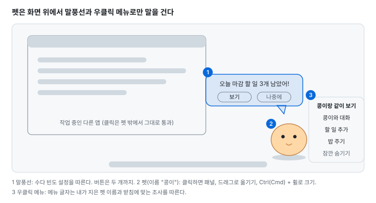
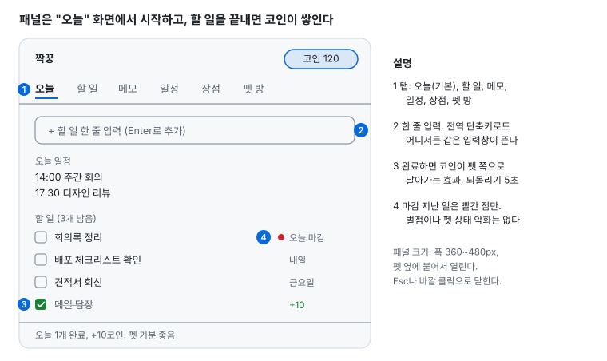
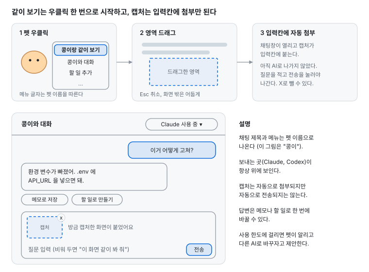
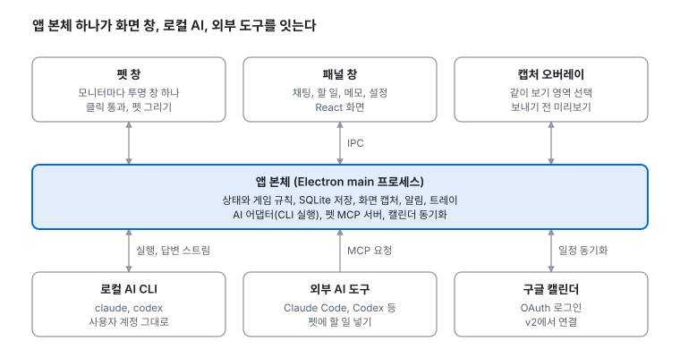

# 짝꿍 (Jjakkung) 기획서

문서 버전 0.2.2 (2026-10-01). 변경 이력은 [CHANGELOG](../CHANGELOG.md)에 남긴다. AI 연동 검증 절차는 [AI CLI 검증 시나리오](tests/ai-cli.md)에 있다.

옆자리 짝꿍처럼 화면 위를 돌아다니는 펫이 할 일, 일정, 메모를 같이 챙기고, 내 컴퓨터에 설치된 AI(Claude, Codex)와 연결돼 "같이 보기"로 화면을 보며 대화하는 데스크톱 앱이다. 맥과 윈도우를 동시에 낸다.

## 개요

일하는 시간을 덜 외롭고 더 재미있게 만드는 것이 목표다. 펫은 귀여운 놀이 상대이면서, 할 일과 일정을 챙기고 AI와 이어 주는 비서 역할을 한다.

**대상 사용자**

- 하루 대부분을 컴퓨터 앞에서 보내는 직장인과 학생
- Claude Code, Codex 같은 로컬 AI를 이미 쓰는 개발자와 기획자
- 할 일 앱을 깔아도 금방 안 보게 되는 사람

**핵심 가치 세 가지**

1. **눈에 보이는 동기**: 할 일을 끝내면 코인이 생기고, 펫이 밥을 먹고 집이 커진다. 해야 할 일이 펫을 돌보는 일로 바뀐다.
2. **AI가 화면 옆에 산다**: 창을 바꾸지 않고 펫에게 말을 걸거나, 화면 일부를 잘라 "같이 보기"로 물어본다. 내가 이미 쓰는 Claude, Codex를 그대로 쓰므로 따로 API 키가 필요 없다.
3. **내 펫**: 사진 한 장으로 내 반려동물이나 좋아하는 캐릭터가 펫이 된다. 먹이와 집도 꾸밀 수 있다.

**설계 원칙**

모든 기능은 이 다섯 가지를 어기지 않는다. 기능 리스트에 따로 적지 않고, 개발 단계마다 지켰는지 확인한다.

1. **방해하지 않는다**: 펫은 사용자가 부르거나 정해 둔 때만 말을 건다. 커서를 뺏거나 창을 가리는 장난은 하지 않는다.
2. **벌주지 않는다**: 며칠 안 켜도, 할 일을 못 끝내도 펫이 아프거나 떠나지 않고 코인도 줄지 않는다. 삐지거나 화내는 연기는 괜찮다. 잃는 것이 없고, 할 일 하나로 바로 풀리면 된다.
3. **AI 없이도 쓸 수 있다**: AI가 없거나 한도에 걸려도 펫, 할 일, 메모, 게임은 모두 동작한다.
4. **내 컴퓨터에만 둔다**: 계정과 서버가 없다. 데이터는 로컬에 저장하고, 밖으로 나가는 것은 사용자가 AI에 직접 보낸 것뿐이다.
5. **가볍다**: 하루 종일 켜 두어도 노트북 배터리와 다른 작업에 티가 나지 않아야 한다 (비기능 목표 참고).

**만들지 않을 것**

- 펫끼리 만나는 온라인 기능, 계정과 서버
- 자체 AI 모델. 이미 설치된 AI를 연결만 한다.
- 코인과 아이템의 거래, 현금 결제. 코인은 할 일로만 얻는다.

## 성공 기준

베타(개발 4단계)에서 아래 다섯 가지로 판단한다. 서버가 없으므로 앱 안 "내 기록" 화면에 숫자를 보여 주고, 베타 사용자가 원할 때 그 화면을 캡처해 의견과 함께 보낸다.

| 지표 | 목표 | 왜 보는가 |
| --- | --- | --- |
| 14일째에도 켜 두는 사람 | 베타 10명 중 6명 이상 | 귀찮아서 지우지 않는지 |
| 하루 완료한 할 일 | 사용자별 중앙값 3개 이상 | 할 일 앱으로 실제 쓰이는지 |
| 펫을 숨긴 시간 비율 | 켜 둔 시간의 30% 미만 | 펫이 방해가 되는지 |
| 같이 보기 사용 | 주 1회 이상 쓰는 사람 절반 이상 | AI 연동이 쓸모 있는지 |
| 앱 강제 종료와 멈춤 | 사용자당 주 0회 | 하루 종일 켜 둘 만큼 안정적인지 |

## 참고 제품

비슷한 제품에서 가져올 것과 피할 것을 정리했다. 조사일은 2026-10-01이다.

| 제품 | 무엇인가 | 가져올 것 | 피할 것 |
| --- | --- | --- | --- |
| [Shimeji-ee](https://kilkakon.com/shimeji/) | 화면을 돌아다니는 캐릭터. 윈도우, 무료, Java 필요 | 캐릭터 팩을 바꿔 끼우는 구조 | 별도 런타임 설치 요구 |
| [Desktop Goose](https://samperson.itch.io/desktop-goose) | 마우스를 뺏고 발자국을 남기는 장난 거위. 윈도우, 맥 | 펫이 쪽지를 들고 오는 연출 | 백신 오탐, 끄기 어려움 ([댓글](https://samperson.itch.io/desktop-goose/comments?after=1661)) |
| [VPet-Simulator](https://store.steampowered.com/app/1920960/VPet/) | 스팀 무료 펫, 애니메이션 200개 이상, 리뷰 95% 긍정 | 먹이 주기, 창작마당으로 아이템과 애니메이션 배포 | 윈도우 전용 |
| [Bongo Cat](https://store.steampowered.com/app/3419430/Bongo_Cat/) | 키 입력으로 포인트를 모으는 고양이. 리뷰 96% 긍정 | "일하는 동안 곁에 있는 친구", 일하는 행동이 곧 보상 | 아이템 현금 거래와 봇 파밍 ([보도](https://www.3djuegos.com/pc/noticias/todo-mundo-sospecha-gato-que-ha-conquistado-steam-incluso-su-creador-hace-eso-lucha-quienes-se-aprovechan)) |
| [Clawd on Desk](https://github.com/rullerzhou-afk/clawd-on-desk) | 코딩 에이전트 상태에 반응하는 Electron 펫, AGPL-3.0 | AI가 생각 중이거나 오류일 때 펫 동작으로 보여 주기 | AGPL 코드 가져다 쓰기 (라이선스가 앱 전체로 번진다) |
| [DeskPet](https://www.producthunt.com/products/deskpet-ai-otter-desktop-companion) | 누르면 Claude 채팅이 열리는 맥 펫 | 펫 클릭 한 번으로 채팅 | 사용자에게 API 키를 따로 받게 하는 진입 장벽 |
| [Habitica](https://apps.apple.com/us/app/habitica-gamified-taskmanager/id994882113) | 할 일을 RPG로 만든 앱 | 할 일 완료로 골드와 펫 보상 | 죽으면 레벨과 장비를 잃는 벌 ([소개](https://aiindigo.com/tutorials/getting-started-with-habitica-gamify-your-productivity)) |
| [Forest](https://apps.apple.com/us/app/forest-focus-for-productivity/id866450515) | 집중하면 나무가 자라는 앱 | 집중 시간이 눈에 보이는 결과로 쌓임 | 실패하면 죽은 나무가 기록에 영원히 남아 죄책감을 줌 |
| [Finch](https://apps.apple.com/us/app/finch-self-care-pet/id1528595748) | 자기돌봄 목표로 새를 키우는 앱, 평점 4.9 | 못 한 날에도 벌이 없다는 점이 칭찬받음 | 석 달쯤 지나면 돌보기가 일처럼 느껴짐 ([리뷰](https://habitbox.app/blog/finch-app-review)) |
| [Duolingo](https://blog.duolingo.com/improving-the-streak) | 연속 학습(스트릭)과 마스코트 Duo의 죄책감 알림으로 유명한 언어 앱 | 스트릭을 지켜 주는 장치가 실제로 효과를 냈다. 하루 빠져도 스트릭이 유지되는 "주말 부적"이 14일 유지율 +4%, 스트릭을 잃을 확률 -5% ([실험 정리](https://econsultancy.com/six-a-b-tests-used-by-duolingo-to-tap-into-habit-forming-behaviour/)). 5일 쉬면 "알림이 소용없는 것 같네..."라는 메시지를 보낸다 | 점점 세지는 죄책감 알림. "불안하다", "공황이 왔다"는 반응이 있다 ([학생 신문](https://nnhsnorthstar.com/22332/opinions/dastardly-duolingo-addressing-the-birds-reign-of-terror/)) |

**정리하면**

- 보상은 Habitica처럼 주되, 벌은 Finch처럼 없앤다.
- 화내는 재미는 Duolingo에서 가져오되, 효과가 확인된 쪽(쉬는 날 보호, 낮은 진입 장벽)을 따르고 알림 폭탄은 따르지 않는다.
- 펫은 Bongo Cat처럼 "일하는 동안 곁에 있는 친구"이고, Desktop Goose처럼 방해하지 않는다.
- AI 상태는 Clawd처럼 펫 동작으로 보여 주되, 코드는 직접 짠다.
- 돌보기가 일이 되지 않게, 배부름이 낮아도 표정만 바뀌고 할 일은 늘지 않는다.

## 하루 사용 흐름

펫은 하루 내내 화면 구석에 있고, 필요할 때만 다가온다. 아래는 수다 빈도 "보통" 기준이다.

1. **출근**: 컴퓨터를 켜면 펫이 화면 아래로 걸어 나온다. 말풍선으로 오늘 일정 2건과 마감이 오늘인 할 일 3개를 알려준다.
2. **오전 작업**: 펫을 클릭해 패널을 열고 "회의록 정리"를 할 일로 넣는다. 집중 타이머를 켜면 펫은 옆에서 조용히 잠든다.
3. **막혔을 때**: 펫(이름이 "콩이"라면)을 우클릭해 "콩이랑 같이 보기"를 고르고 에러 화면을 드래그한다. 캡처가 채팅 입력칸에 바로 첨부되고, 질문을 적어 전송하면 Claude가 답한다. 답을 메모로 저장하거나 할 일로 바꾼다.
4. **뭐부터 할지 모를 때**: 채팅에 "오늘 뭐부터 할까?"라고 물으면, AI가 내 할 일 목록과 마감을 보고 순서를 제안한다.
5. **점심**: 오전에 끝낸 할 일로 받은 코인으로 먹이를 사서 준다. 공을 던지면 펫이 화면을 뛰어다닌다.
6. **오후 회의**: 발표 모드나 전체 화면 앱이 켜지면 펫이 알아서 숨는다. 화면 공유는 앱이 알아낼 수 없으므로, 공유 전에 단축키로 숨긴다.
7. **지칠 때**: 2시간 넘게 쉬지 않았으면 펫이 산책을 조른다. 산책을 누르면 펫이 화면 바닥을 따라 걸으며 스트레칭을 권한다.
8. **퇴근**: 오늘 끝낸 일과 받은 코인을 보여 주고, 내일로 넘길 할 일을 물어본다. 펫은 집으로 들어가 잔다.

## 기능 리스트

53개 기능 중 MVP는 14개, v1은 29개, v2는 10개다. MVP는 "내가 일주일 동안 실제로 쓸 수 있는 최소"로 잘랐다. 출처가 "요청"이면 처음 아이디어에 있던 것, "제안"이면 사용자 입장에서 필요하다고 보고 덧붙인 것이다.

| 영역 | 기능 | 설명 | 출처 | 우선순위 |
| --- | --- | --- | --- | --- |
| 펫 | 화면 위 펫 표시 | 투명 창, 항상 위. 펫이 아닌 곳은 클릭이 아래 앱으로 그대로 통과. 사진이 없으면 기본 모양으로 시작 | 요청 | MVP |
| 펫 | 드래그로 옮기기 | 집어서 원하는 곳에 둔다. 위치는 다음 실행에도 유지 | 제안 | MVP |
| 펫 | 크기 조절 | 설정 슬라이더, 펫 위에서 Ctrl(맥은 Cmd) + 휠, 단축키로 50%~300% | 요청 | MVP |
| 펫 | 기본 행동 | 걷기, 앉기, 졸기, 생각 중 | 제안 | MVP |
| 펫 | 사진으로 펫 만들기 | 사진 업로드, 로컬 배경 제거, 테두리 다듬기. 통통 튀기, 찌그러짐, 기울기로 사진 한 장을 움직인다 | 요청 | MVP |
| 펫 | 방해 금지 | 전체 화면 앱과 발표 모드에서 자동으로 숨고, 단축키로 바로 숨긴다 | 제안 | MVP |
| 펫 | 내가 지은 이름으로 부르기 | 메뉴, 말풍선, 채팅 제목에 펫 이름이 나온다. "콩이랑", "밤이랑"처럼 조사(이랑/랑, 와/과, 이/가)를 받침에 맞춰 붙인다 | 요청 | MVP |
| 펫 | 수다 빈도 조절 | 조용히, 보통, 수다쟁이 세 단계 (펫 동작 규칙 참고) | 제안 | MVP |
| 펫 | 삐짐 게이지 | 오래 안 쓰면 삐지고, 매운맛을 켜면 극대노까지 간다. 잃는 것은 없고 할 일 하나로 바로 화해 (펫 동작 규칙 참고) | 요청 | v1 |
| 펫 | 던지기 | 던지면 떨어지며 튕긴다 | 제안 | v1 |
| 펫 | 추가 행동 | 하품, 창 위에 올라앉기, 기지개 | 제안 | v1 |
| 펫 | 쓰다듬기 반응 | 마우스로 문지르면 하트가 뜨고 기분이 오른다 | 제안 | v1 |
| 펫 | 움직이는 이미지 올리기 | GIF나 스프라이트 시트를 올리면 그대로 움직인다 | 제안 | v1 |
| 펫 | 상태별 포즈 사진 | 기쁨, 졸림, 배고픔 사진을 따로 올리면 상태에 맞춰 바뀐다 | 제안 | v1 |
| 펫 | 멀티 모니터 | 모니터 사이를 걸어서 넘어간다 | 제안 | v1 |
| 펫 | 기본 펫 추가 | 그림 작가가 만든 기본 캐릭터 2종 | 제안 | v1 |
| 펫 | 여러 마리 | 펫 두 마리 이상을 동시에 띄운다 | 제안 | v2 |
| 펫 | 펫 공유 | 내가 만든 펫을 파일 하나로 친구에게 준다 | 제안 | v2 |
| 놀이 | 공놀이 | 공을 던지면 쫓아가서 물어온다 | 요청 | v1 |
| 놀이 | 산책 | 화면 바닥을 따라 걷고 산책 시간을 기록 | 요청 | v1 |
| 놀이 | 휴식 권유 | 오래 쉬지 않으면 산책, 물 마시기, 스트레칭을 권한다 | 제안 | v1 |
| 놀이 | 미니 게임 | 숨바꼭질 같은 짧은 놀이 | 제안 | v2 |
| 생산성 | 할 일 목록 | 추가, 완료, 되돌리기, 마감일, 중요 표시 | 요청 | MVP |
| 생산성 | 빠른 입력 | 전역 단축키로 어디서든 한 줄 입력해 할 일로 저장 | 제안 | MVP |
| 생산성 | 메모와 노트 | 마크다운 메모, 펫을 눌러 바로 연다 | 요청 | v1 |
| 생산성 | 일정 입력과 알림 | 시간이 되면 펫이 말풍선으로 알린다 | 요청 | v1 |
| 생산성 | 오늘 브리핑 | 출근 시 오늘 일정과 마감 할 일을 요약 | 제안 | v1 |
| 생산성 | 집중 타이머 | 25분 집중, 5분 휴식. 집중 중엔 펫이 조용히 자고, 끝내면 코인 | 제안 | v1 |
| 생산성 | 반복 할 일 | 매일, 매주 반복되는 할 일 | 제안 | v1 |
| 생산성 | 구글 캘린더 연동 | 일정 읽기부터, 이후 쓰기까지 | 요청 | v2 |
| 생산성 | 하루 회고 | 퇴근 때 끝낸 일 요약, 못 끝낸 일은 내일로 넘기기 | 제안 | v2 |
| AI | 채팅 | 설치된 AI(claude, codex)를 찾아 고르고, 답변이 실시간으로 흘러나온다 | 요청 | MVP |
| AI | 같이 보기 | 펫 우클릭 메뉴 "(이름)랑 같이 보기"로 시작. 영역을 드래그하면 캡처가 채팅 입력칸에 자동 첨부되고, 전송을 눌러야 AI로 나간다. 맥 화면 기록 권한 안내 포함 | 요청 | MVP |
| AI | 답변을 메모, 할 일로 | 답변 아래 버튼 하나로 메모나 할 일이 된다 | 요청 | v1 |
| AI | 내 할 일을 아는 대화 | "오늘 뭐부터 할까?"에 AI가 내 할 일과 일정을 보고 답한다 | 제안 | v1 |
| AI | AI로 정리 | 메모를 할 일로 쪼개기, 회의 메모 요약 | 요청 | v1 |
| AI | AI 바꾸기 | 한 AI가 한도에 걸리거나 오류면 다른 AI로 바꾸자고 제안 | 제안 | v1 |
| AI | 기록 남기지 않기 | 이번 대화를 AI 쪽에도 저장하지 않는 모드 | 제안 | v1 |
| AI | 펫 성격과 말투 | 존댓말, 반말, 성격 프리셋 | 제안 | v1 |
| AI | 펫 MCP 서버 | Claude Code나 Codex에서 "펫 할 일에 넣어줘"가 된다 | 요청 | v1 |
| AI | 외부 MCP 활용 | CLI에 이미 설정된 MCP(노션, 슬랙 등)를 펫 채팅에서도 쓴다 | 요청 | v2 |
| 게임 | 코인과 밥 주기 | 할 일 완료로 코인을 받고, 코인으로 먹이를 사서 준다 | 요청 | MVP |
| 게임 | 상점 | 먹이, 장난감, 집 꾸미기 아이템 | 요청 | v1 |
| 게임 | 커스텀 먹이 | 사진을 올려 나만의 먹이 아이템을 만든다 | 요청 | v1 |
| 게임 | 집 업그레이드 | 단계별 집, 화면 구석에 놓인다 | 요청 | v1 |
| 게임 | 연속 기록과 업적 | 7일 연속 달성 같은 기록. 끊겨도 잃는 것은 없다 | 제안 | v2 |
| 앱 | 트레이 메뉴 | 보이기, 숨기기, 설정, 의견 보내기, 종료 | 제안 | MVP |
| 앱 | 첫 실행 안내 | 펫 만들기, 권한, 단축키를 세 화면으로 안내 | 제안 | v1 |
| 앱 | 자동 실행과 업데이트 | 로그인 시 자동 실행, 새 버전 자동 설치 | 제안 | v1 |
| 앱 | 내 기록 | 하루 완료한 할 일, 집중 시간, 펫 숨긴 시간 같은 로컬 통계 | 제안 | v1 |
| 앱 | 백업과 옮기기 | 데이터를 파일로 내보내 다른 PC로 옮긴다 | 제안 | v2 |
| 앱 | 단축키 바꾸기 | 모든 전역 단축키를 사용자가 바꾼다 | 제안 | v2 |
| 앱 | 다국어 | 한국어, 영어 | 제안 | v2 |

## 펫 동작 규칙

**마우스로 다루기**

| 동작 | 결과 |
| --- | --- |
| 왼쪽 클릭 | 패널 열기, 닫기 |
| 우클릭 | 메뉴: "(이름)랑 같이 보기", "(이름)와 대화", 할 일 추가, 밥 주기, 잠깐 숨기기, 설정 |
| 드래그 | 옮기기 |
| 펫 위에서 Ctrl(맥은 Cmd) + 휠 | 크기 조절. 휠만 굴리면 아래 창이 스크롤되도록 그대로 넘긴다 |

메뉴 글자의 "(이름)"과 조사는 펫 이름을 따른다. 이름이 "콩이"면 "콩이랑 같이 보기", "콩이와 대화", 이름이 "밤"이면 "밤이랑 같이 보기", "밤과 대화"다. 이름 끝 글자에 받침이 있으면 "이랑, 과, 이", 없으면 "랑, 와, 가"를 붙인다.

펫은 아래 상태 중 하나에 있다. 위에 있는 상태일수록 우선한다.

| 상태 | 들어가는 조건 | 나오는 조건 | 모습 |
| --- | --- | --- | --- |
| 숨김 | 숨기기 단축키, 트레이에서 숨기기, 전체 화면 앱이나 발표 모드 감지 | 다시 보이기, 감지가 끝남 | 화면에서 사라진다. 알림은 쌓아 두었다가 나올 때 한 번에 |
| 잡힘 | 사용자가 펫을 누르고 끈다 | 놓는다 | 매달린 모습 |
| 생각 중 | AI에 질문을 보냈다 | 답변이 끝나거나 실패 | 머리 위에 점 세 개 |
| 말하기 | 말풍선을 띄울 일이 생겼다 (아래 표) | 사용자가 누르거나 8초가 지남 | 말풍선, 버튼 최대 두 개 |
| 신남 | 코인을 받았다, 먹이를 먹었다 | 3초 뒤 | 통통 튄다 |
| 잠 | 사용자 입력이 10분 없거나 집중 타이머 중 | 입력이 생기거나 타이머 종료 | 눈 감고 숨 쉬는 동작 |
| 삐짐 (v1) | 삐짐 게이지 1단계 이상 | 할 일 하나 완료, 또는 쓰다듬기와 밥 주기 둘 다 | 단계별 모습 (아래 표) |
| 기본 | 위에 해당 없음 | | 걷기, 앉기를 무작위로. 배부름 30 미만이면 배고픈 표정만 더한다 |

**수다 빈도**

| 말풍선 종류 | 조용히 | 보통 (기본값) | 수다쟁이 |
| --- | --- | --- | --- |
| 일정 시작 알림 (v1) | 켬 | 켬 | 켬 |
| 출근 브리핑 (v1) | 끔 | 켬 | 켬 |
| 마감 알림 | 끔 | 마감 당일 한 번 | 마감 당일 오전, 오후 |
| 휴식 권유 (v1) | 끔 | 2시간마다 | 1시간마다 |
| 혼잣말과 칭찬 | 끔 | 끔 | 30분마다 |
| 한 시간 최대 개수 | 일정 알림만 | 3개 | 6개 |

사용자가 말풍선을 "나중에"로 세 번 연속 닫으면, 펫이 "좀 조용히 할까?"라고 한 번 묻고 빈도를 한 단계 낮출지 고르게 한다.

**삐짐 게이지 (v1)**

오래 안 쓰면 펫이 삐진다. Duolingo의 화내는 재미는 가져오되, 잃는 것은 없게 만든다.

| 단계 | 쌓이는 때 | 모습과 대사 | 매운맛 |
| --- | --- | --- | --- |
| 0 평온 | 마지막 활동 뒤 1일 미만 | 평소대로 | |
| 1 삐짐 | 1일 | 등 돌리고 앉아 곁눈질. "...왔어?" | |
| 2 투정 | 3일 | 팔짱, 볼 부풀리기. "흥, 나 없어도 잘 지냈나 보네" | |
| 3 대노 | 7일 | 얼굴이 빨개지고 화면 구석에서 발을 구른다. "7일. 7일이야. 내가 세고 있었어" | 켜야 열림 |
| 4 체념 | 14일 이상 | 짐 싸는 연기. "이제 안 기다릴 거야... 아마도" | 켜야 열림 |

- **활동**: 할 일 완료, 펫 클릭, 채팅, 밥 주기 중 하나라도 하면 활동으로 센다.
- **쉬는 날은 세지 않는다**: 설정의 쉬는 날(기본 토, 일)은 날짜 계산에서 뺀다. 월요일 아침에 펫이 삐져 있지 않게 한다. Duolingo에서 효과가 확인된 "주말 부적"과 같은 생각이다.
- **매운맛은 고른 사람만**: 기본(순한맛)은 2단계 투정까지다. 3, 4단계는 설정에서 "매운맛"을 켠 사람에게만 열린다.
- **알림으로 조르지 않는다**: 앱이 꺼져 있는 동안 OS 알림을 보내지 않는다. 앱을 켰을 때 화면 안에서만 반응한다 ("왜 이제 왔어!"). 켜 둔 채 안 쓰는 경우도 말풍선은 단계가 오를 때 한 번뿐이고, 수다 빈도와 방해 금지를 따른다.
- **바로 풀린다**: 할 일 하나를 끝내면(또는 쓰다듬기와 밥 주기를 둘 다 하면) 0으로 돌아가고 화해 장면이 나온다. 오래 떨어져 있을수록 화해 보너스 코인이 크다 (게임 규칙 참고).
- **잃는 것은 없다**: 코인, 배부름 외 수치, 친밀도, 아이템은 줄지 않는다. 삐짐은 표정과 대사뿐이다.

## 게임 규칙

코인은 일을 끝낼 때만 생기고, 펫을 돌보는 데만 쓴다. 코인은 줄어들지 않고 거래할 수 없다.

| 구분 | 항목 | 초안 값 |
| --- | --- | --- |
| 획득 | 할 일 1개 완료 | 10코인 (하루 최대 20개까지) |
| 획득 | 집중 타이머 1회 | 5코인 |
| 획득 | 마감 전 완료 | +5코인 |
| 획득 | 산책, 휴식 권유 따르기 | 3코인 |
| 획득 | 화해 보너스 (v1) | 삐짐 1단계 5, 2단계 10, 3단계 20, 4단계 30코인. 7일에 한 번까지 |
| 소비 | 기본 먹이 | 5코인 |
| 소비 | 커스텀 먹이 만들기 | 50코인 (한 번) |
| 소비 | 장난감 | 30~100코인 |
| 소비 | 집 업그레이드 | 단계별 200, 500, 1,000코인 |

**펫 상태 수치** (0~100)

- **배부름**: 한 시간에 2씩 줄고, 기본 먹이 하나에 20 오른다. 0이 되어도 배고픈 표정만 짓는다.
- **기분**: 쓰다듬기, 놀이, 할 일 완료로 오르고 하루가 지나면 50으로 돌아간다.
- **친밀도**: 쌓이기만 하고 줄지 않는다. 100, 300, 600마다 새 동작이나 대사가 열린다.

**지켜야 할 규칙**

- 할 일을 잘게 쪼개 코인을 버는 것을 막으려고 하루 상한을 둔다.
- 화해 보너스는 일부러 안 들어오는 것보다 할 일을 하는 편이 늘 이득이 되도록 작게 둔다 (14일 쉬고 받는 30코인 < 할 일 4개의 40코인).
- 완료를 되돌리면 받은 코인도 되돌린다. 이미 써 버렸으면 잔액이 음수가 되지 않게 0에서 멈춘다.
- 값은 초안이다. 베타에서 일주일 평균 획득량과 소비량을 보고 조정한다.

## 화면 설계

화면은 펫 창, 패널, 채팅, 캡처 오버레이, 설정 다섯 가지다.

| 화면 | 열리는 때 | 들어가는 것 | 단계 |
| --- | --- | --- | --- |
| 펫 창 | 항상 | 펫, 말풍선, 우클릭 메뉴 | MVP |
| 패널 | 펫 클릭, 우클릭 메뉴, 단축키 | 오늘, 할 일, 메모, 일정, 상점, 펫 방 탭 | MVP는 오늘과 할 일만 |
| 빠른 입력 | 전역 단축키 | 한 줄 입력창 | MVP |
| 채팅 | 우클릭 메뉴의 "(이름)와 대화", 같이 보기 | AI 선택, 대화, 입력과 첨부, 캡처 버튼 | MVP |
| 캡처 오버레이 | 같이 보기 | 영역 드래그, 화면 밖은 어둡게, Esc 취소 | MVP |
| 펫 만들기 | 처음 실행, 설정 | 사진 고르기, 배경 제거 결과 다듬기, 이름 짓기 | MVP |
| 설정 | 트레이, 패널 | 일반, 펫, AI, 개인정보, 단축키 | MVP는 일반, 펫, AI |

## 시스템 구조

앱 본체 하나가 모든 연결을 맡는다. 화면 창들은 본체와만 이야기하고, 펫 MCP 서버가 있어서 Claude Code 같은 외부 도구도 펫에 할 일을 넣을 수 있다.

## 데이터 모델

모든 데이터는 SQLite 파일 하나와 이미지 폴더에 둔다. 위치는 Electron 기본 사용자 데이터 폴더다.

- 맥: `~/Library/Application Support/Jjakkung/`
- 윈도우: `%APPDATA%\Jjakkung\`

| 테이블 | 주요 칸 | 비고 |
| --- | --- | --- |
| pet | id, 이름, 이미지 경로, 크기, 위치, 성격, 배부름, 기분, 친밀도, 마지막 활동 시각, 삐짐 단계 | MVP는 한 마리 |
| todo | id, 제목, 마감일, 중요, 반복 규칙, 완료 시각, 받은 코인 | 완료를 되돌리면 받은 코인도 되돌린다 |
| note | id, 제목, 본문(마크다운), 출처(직접, AI 답변), 만든 시각 | v1 |
| event | id, 제목, 시작, 끝, 출처(로컬, 구글), 외부 id | 구글은 v2 |
| coin_log | id, 금액(+/-), 이유, 관련 id, 시각 | 잔액은 합계로 계산해 장부가 어긋나지 않게 한다 |
| item | id, 종류(먹이, 장난감, 집), 이름, 이미지, 가격, 보유 수 | 커스텀 먹이도 여기 |
| conversation | id, AI 종류, CLI 세션 id, 기록 남김 여부, 만든 시각 | 세션 id 로 대화를 이어 간다 |
| message | id, 대화 id, 역할, 본문, 첨부 캡처 id, 시각 | |
| capture | id, 파일 경로, 크기, 보낸 곳, 만든 시각, 지울 시각 | 아래 개인정보 규칙 |
| daily_stat | 날짜, 완료 할 일 수, 집중 분, 펫 숨긴 분, 같이 보기 횟수 | 성공 기준 화면용 |
| setting | 키, 값 | 수다 빈도, 쉬는 날, 매운맛, 단축키, AI 설정 |

스키마 버전을 파일에 적고, 앱이 업데이트될 때 순서대로 바꾼다. 바꾸기 전에 파일을 하나 복사해 둔다.

## 데이터와 개인정보

밖으로 나가는 데이터는 사용자가 AI에 보낸 것뿐이다. 앱 자체는 서버와 통신하지 않고, 사용 통계도 보내지 않는다. 예외는 업데이트 확인(GitHub Releases)과 v2 구글 캘린더뿐이다.

| 데이터 | 어디 있나 | 밖으로 나가나 | 언제 지우나 |
| --- | --- | --- | --- |
| 할 일, 메모, 일정, 게임 기록 | 로컬 SQLite | 아니요. v1 "내 할 일을 아는 대화"를 켜면 질문할 때 오늘 할 일 제목만 AI에 함께 보낸다 | 사용자가 지울 때 |
| 펫 사진 | 로컬 이미지 폴더 | 아니요. 배경 제거도 로컬에서 한다 | 펫을 지울 때 |
| 캡처 이미지 | 로컬 임시 폴더 | 첨부한 채 전송을 누른 것만 AI로 | 전송하지 않고 뺀 캡처는 바로, 보낸 캡처는 7일 뒤. "대화에 남기기"를 고르면 대화를 지울 때 |
| 대화 내용 | 로컬 SQLite, 그리고 AI CLI 쪽 세션 기록 | AI 회사(Anthropic, OpenAI)로 | 앱 기록은 사용자가 지울 때. CLI 쪽 기록은 각 CLI 규칙을 따른다 |
| 구글 로그인 토큰 (v2) | OS 키체인 (Electron safeStorage) | 구글로만 | 연결을 끊을 때 |

**사용자에게 보이는 약속**

- 채팅창 위에 지금 대화가 어디로 가는지(Claude 또는 Codex) 항상 표시한다.
- 캡처는 입력칸에 첨부만 되고 자동으로 나가지 않는다. 사용자가 첨부 썸네일을 보고 전송을 눌러야 나간다. 썸네일의 X로 뺄 수 있다. 자동 전송 옵션은 만들지 않는다.
- "기록 남기지 않기"(v1)를 켜면 claude 는 `--no-session-persistence`, codex 는 `--ephemeral` 로 불러 AI 쪽에도 세션을 남기지 않는다.
- 설정의 "개인정보" 탭에서 저장된 캡처 수와 용량을 보고 한 번에 지울 수 있다.

## AI 연동 규격

AI는 사용자가 설치하고 로그인한 CLI를 하위 프로세스로 불러 쓴다. 아래 명령은 2026-10-01 이 컴퓨터에서 실제로 돌려 확인했다 (Claude Code 2.1.286, codex-cli 0.155.1). 자세한 절차와 결과는 [AI CLI 검증 시나리오](tests/ai-cli.md)에 있다.

| 항목 | Claude Code | Codex |
| --- | --- | --- |
| 설치 확인 | 실행 파일 경로 탐색 | 실행 파일 경로 탐색 |
| 로그인 확인 | `claude auth status` (JSON, `loggedIn`) 확인됨 | `codex login status` (문구) 확인됨 |
| 질문 보내기 | `claude -p --input-format stream-json --output-format stream-json --verbose` | `codex exec "<질문>" --json --skip-git-repo-check -s read-only` |
| 이미지 첨부 | stream-json 입력에 이미지 블록(base64). 확인됨 | `-i <파일>`. 질문을 `-i` 앞에 둔다. 한도 때문에 미확인 |
| 대화 이어가기 | 첫 질문 `--session-id <uuid>`, 다음부터 `--resume <uuid>`. 확인됨 | `thread.started` 의 `thread_id` 저장 후 `codex exec resume <id>`. 미확인 |
| 펫 성격 | `--append-system-prompt "<성격 지시>"`. 확인됨 | 질문 앞에 성격 지시를 붙인다. 미확인 |
| 사용자 설정 격리 | `--setting-sources ""`, `--tools ""`. 훅 6개가 0개로 줄어든 것 확인 | 별도 프로필이나 빈 설정 폴더. 미확인 |
| 끝 판정 | `type: result` 이벤트 | `turn.completed` 또는 `turn.failed` 이벤트 |
| 첫 답 시간 (실측) | 간단한 질문 3.4~4.2초, 이미지 질문 4.0초 (프로세스 시작 포함 7초) | 미측정 |

**동작 규칙**

1. **격리가 기본이다.** 펫 채팅은 사용자의 Claude 훅, CLAUDE.md, MCP 설정을 타지 않는다. 설정에서 "내 AI 설정 그대로 쓰기"를 켜면 격리를 푼다.
2. **도구는 끈다.** 펫 채팅의 AI는 파일을 고치거나 명령을 실행하지 않는다 (`--tools ""`, `-s read-only`). v1 펫 MCP 서버의 할 일 도구만 허용한다.
3. **시간 제한**: 첫 답이 60초 안에 오지 않으면 중단하고 펫이 "AI가 대답이 없어"라고 알린다.
4. **사용 한도**: 오류 문구에 한도 초과가 있으면 펫이 "오늘은 Codex가 지쳤대. 19:48 이후에 다시 해 보자"처럼 알리고, 다른 AI가 있으면 바꾸자고 제안한다 (v1). 실제 codex 문구: "You've hit your usage limit ... try again at 7:48 PM".
5. **출력 해석**: JSON으로 읽히지 않는 줄은 버린다. codex는 경고도 `error` 항목으로 보내므로 실패 판정은 `turn.failed` 로만 한다.
6. **어댑터 분리**: AI마다 어댑터를 따로 두고, 앱 시작 때 CLI 버전을 기록한다. 버전이 바뀌면 검증 시나리오 C1~C5, X1~X4를 다시 돌린다.
7. **비용 안내**: AI 사용량은 사용자의 구독 한도에서 빠진다는 것을 첫 채팅 때 한 번 알린다.

## 비기능 목표

0단계 기술 검증에서 실측하고, 못 맞추면 목표를 고칠지 구조를 고칠지 정한다.

| 항목 | 목표 |
| --- | --- |
| 가만히 있을 때 CPU | 1% 이하 (펫이 자거나 앉아 있을 때) |
| 메모리 | 창 세 개(펫, 패널, 채팅) 열린 상태에서 400MB 이하 |
| 켜지는 시간 | 아이콘을 누르고 펫이 보일 때까지 3초 이하 |
| 애니메이션 | 최대 30fps. 배터리 사용 중이거나 절전 모드면 15fps, 잠 상태에서는 멈춤 |
| 같이 보기 | 드래그를 끝내고 입력칸에 첨부될 때까지 0.5초 이하 |
| 화면 배율 | 100%~200% 배율, 모니터마다 배율이 달라도 펫 크기가 같아 보인다 |
| 설치 파일 | 맥, 윈도우 각각 150MB 이하 |
| 데이터 | 앱이 갑자기 꺼져도 마지막으로 완료한 할 일이 남아 있다 |

## 기술 스택

**Electron + TypeScript로 간다.** 펫 앱의 핵심인 "펫이 아닌 투명한 곳만 클릭 통과"를 맥과 윈도우 모두에서 공식 API로 지원하는 후보는 Electron 하나뿐이었다. 대가는 설치 파일 80MB 이상과 더 큰 메모리다. 2순위는 Tauri v2다.

| 후보 | 최신 버전 (2026-10-01 확인) | 투명 영역 클릭 통과 | MCP SDK 언어 | 판단 |
| --- | --- | --- | --- | --- |
| [Electron](https://releases.electronjs.org/) | 44.5.1 | `setIgnoreMouseEvents(true, {forward: true})`를 맥, 윈도우에서 공식 지원 | TypeScript (Tier 1) | **채택** |
| [Tauri v2](https://v2.tauri.app/release/tauri/) | 2.12.0 | 창 전체 단위만. 투명 영역만 통과하려면 커서 위치를 계속 검사하는 우회 코드 필요 | Rust (Tier 1) | 2순위 |
| [Wails](https://github.com/wailsapp/wails/releases) | v2.14.0, v3는 베타 | v3에 있으나 이벤트 전달은 확인 못 함 | Go (Tier 1) | 베타라 제외 |
| [Electrobun](https://github.com/blackboardsh/electrobun) | v2.0.2 | 웹뷰 단위 통과만 확인 | TypeScript | 제외 |
| Flutter | 3.x | 플러그인(window_manager)에 의존 | 공식 Dart SDK 없음 | 제외 |
| [Avalonia](https://docs.avaloniaui.net/docs/how-to/window-how-to) | 11~12 | 문서에 미지원으로 명시 | C# (Tier 1) | 제외 |
| Qt | 6.10 | 창 전체만 통과 | 공식 C++ SDK 없음 | 제외 |

**Electron을 고른 근거**

1. **클릭 통과가 공식 기능이다.** Tauri는 같은 기능 요청([#2090](https://github.com/tauri-apps/tauri/issues/2090))에 16ms마다 픽셀을 검사하는 우회책만 있다. 2026-08에는 데스크톱 펫 개발사가 클릭 통과를 켜고 끌 때 윈도우 10 화면이 검게 변하는 버그([#15947](https://github.com/tauri-apps/tauri/issues/15947))를 올렸고 아직 열려 있다.
2. **두 OS가 같은 브라우저 엔진을 쓴다.** Electron은 Chromium을 함께 묶는다. 배경 제거 모델(ONNX, WASM), 캡처, 애니메이션을 한 번만 검증하면 된다. Tauri는 맥 WKWebView와 윈도우 WebView2를 따로 확인해야 하고, 맥에서 DMG로 묶으면 투명 창이 흰 창이 되는 버그([#13415](https://github.com/tauri-apps/tauri/issues/13415))도 있다.
3. **필요한 것이 다 들어 있다.** 영역 캡처(desktopCapturer), 맥 화면 기록 권한 확인, CLI 실행(Node child_process), 트레이, 전역 단축키가 모두 기본 기능이다.
4. **MCP 서버를 같은 언어로 넣는다.** MCP 공식 TypeScript SDK를 앱 본체에 그대로 올린다.
5. **실제 펫 앱이 있다.** Electron으로 만든 데스크톱 펫(Zpet, Clawd on Desk 등)이 같은 구조(투명, 항상 위, 펫 밖 클릭 통과)로 돌아간다.

**대가와 대응**

- 크기: 비교 글 기준 Hello World 앱이 Electron 85MB, Tauri 3.2MB다([출처](https://tech-insider.org/tauri-vs-electron-2026/)). 펫 앱 용도에서는 감수한다.
- 윈도우 이벤트 전달 버그([#30808](https://github.com/electron/electron/issues/30808), [#48035](https://github.com/electron/electron/issues/48035))가 열려 있다. 0단계에서 윈도우 10과 11 실기기로 확인하고, 안 되면 커서 위치 검사 방식으로 바꾼다.
- 맥 여러 모니터: "디스플레이마다 별도 Spaces" 설정에서는 창이 한 화면에 묶인다. 모니터마다 투명 창을 하나씩 두는 구조로 설계한다.
- 방해 금지 감지: 화면 공유 중인지 알려 주는 API는 없다(`setContentProtection` 은 캡처를 막기만 한다). 윈도우는 `SHQueryUserNotificationState` 의 [발표, 전체 화면 상태](https://learn.microsoft.com/en-us/windows/win32/api/shellapi/ne-shellapi-query_user_notification_state)로, 맥은 공개 API가 없어 [창 목록으로 추정](https://developer.apple.com/forums/thread/792917)한다. 그래서 숨기기 단축키를 MVP에 넣었다.

**초안 구성**

| 역할 | 선택 |
| --- | --- |
| 앱 껍데기 | Electron |
| 언어 | TypeScript |
| 화면 (채팅, 할 일, 설정) | React + Vite |
| 펫 그리기 | Canvas 2D로 시작, 무거워지면 PixiJS |
| 저장 | SQLite (로컬 파일 하나) |
| 배경 제거 | ONNX Runtime Web 위에서 상업 이용이 되는 모델. 후보 [BiRefNet](https://github.com/ZhengPeng7/BiRefNet) (MIT), [MODNet](https://github.com/ZHKKKe/MODNet) (Apache 2.0), [U-2-Net](https://github.com/xuebinqin/U-2-Net) (Apache 2.0). 1단계에서 품질과 속도로 고른다 |
| MCP | 공식 TypeScript SDK |
| 패키징과 업데이트 | electron-builder, GitHub Releases |

**쓰지 않을 것 (라이선스)**

- [@imgly/background-removal](https://github.com/imgly/background-removal-js): AGPL이라 앱 전체 공개 의무가 생긴다.
- [BRIA RMBG-1.4](https://huggingface.co/briaai/RMBG-1.4), [2.0](https://huggingface.co/briaai/RMBG-2.0): CC BY-NC 4.0, 비상업용만 허용된다. rembg의 기본 모델이 이것이라 rembg를 쓸 때도 모델을 바꿔야 한다.
- Clawd on Desk 등 AGPL 펫 앱의 코드.

## 설치와 배포

맥은 dmg, 윈도우는 exe 설치 파일로 내고, GitHub Releases에 올려 자동 업데이트한다. npm은 개발자가 아닌 사용자가 쓰지 않으므로 제외한다.

| 항목 | 맥 | 윈도우 |
| --- | --- | --- |
| 설치 파일 | dmg (애플 실리콘, 인텔 둘 다) | exe (NSIS 설치기) |
| 빌드 위치 | GitHub Actions 맥 러너 | GitHub Actions 윈도우 러너 |
| 서명 | Apple Developer ID 서명과 공증. [개발자 프로그램 연 $99](https://developer.apple.com/programs/) | [Azure Artifact Signing](https://devclass.com/2026/01/14/code-signing-windows-apps-may-be-easier-and-more-secure-with-new-azure-artifact-service/) Basic 월 $9.99. 신청 대상이 미국, 캐나다 개인과 EU, 영국 조직이라 한국 개인 신청 가능 여부는 미확인 |
| 서명 없을 때 | "확인되지 않은 개발자" 차단, 우클릭 열기 안내 필요 | SmartScreen 경고, "추가 정보, 실행" 안내 필요. 백신 오탐 위험도 커진다 |
| 권한 | 화면 기록(같이 보기), 알림 | 특별한 권한 없음 |
| 자동 실행 | 로그인 항목 | 시작 프로그램 |

**배포 순서**

1. 베타는 서명 없이 지인에게 나눈다. 설치 안내문에 경고 창 넘기는 법을 그림으로 넣는다.
2. 공개 전에 맥 공증부터 붙인다. 맥은 경고를 넘기는 과정이 더 길어 이탈이 크다.
3. 윈도우 서명은 Azure 신청 가능 여부를 확인하고, 안 되면 일반 코드 서명 인증서를 산다.
4. 개발자 사용자를 위해 Homebrew cask, winget 등록은 이후에 검토한다.

맥 App Store와 Microsoft Store는 처음 범위에서 뺀다. 항상 위 투명 창, 화면 캡처, 외부 CLI 실행이 스토어 샌드박스 제약에 걸릴 가능성이 커서 따로 확인이 필요하다.

**구글 캘린더 연동 조건 (v2)**

- 데스크톱 앱은 [루프백 주소와 PKCE](https://developers.google.com/identity/protocols/oauth2/native-app)로 로그인한다.
- 캘린더 읽기는 [민감 범위](https://developers.google.com/identity/protocols/oauth2/production-readiness/sensitive-scope-verification)라 공개하려면 구글 검수가 필요하다. 개인정보처리방침, 공개 홈페이지, 시연 영상, 도메인 소유 확인을 준비해야 한다.
- 검수 전에는 [미검증 앱 사용자가 누적 100명](https://support.google.com/cloud/answer/7454865)까지다. 베타는 이 안에서 한다.

## 개발 단계

기능보다 먼저 "두 OS에서 어려운 세 가지가 되는가"를 확인한다. 여기서 막히면 기술 스택을 바꾼다. 각 단계의 완료 기준을 넘어야 다음으로 간다.

1. **0단계, 기술 검증**: 투명 창 클릭 통과, 영역 캡처, claude/codex 실행과 답변 받기. 비기능 목표를 처음 잰다.
    - 완료 기준: 맥과 윈도우 10, 11에서 세 가지가 동작한다. 검증 시나리오 C1~C5, X1~X4 통과.
2. **1단계, 펫**: 화면 표시, 드래그, 크기 조절, 기본 행동, 사진으로 펫 만들기, 방해 금지, 수다 빈도.
    - 완료 기준: 아무 사진 10장을 넣어 보고 8장 이상이 자연스럽게 나온다. 하루 켜 둬도 일을 방해하지 않는다. 가만히 있을 때 CPU 1% 이하.
3. **2단계, 할 일과 코인**: 할 일, 빠른 입력, 코인과 밥 주기.
    - 완료 기준: 내가 일주일 동안 실제 할 일 앱으로 쓴다.
4. **3단계, AI**: 채팅, 같이 보기.
    - 완료 기준: 두 AI 모두 이미지 질문이 된다. 캡처부터 첫 답까지 10초 이하.
5. **4단계, MVP 베타**: 트레이 메뉴, 설치 파일. 지인 5~10명에게 배포한다.
    - 완료 기준: 두 OS에서 설치 파일만으로 설치하고 실행된다. 2주 뒤 성공 기준 다섯 가지를 확인한다.
6. **5단계, v1**: 메모, 일정과 알림, 오늘 브리핑, 집중 타이머, 내 할 일을 아는 대화, 상점, 집, 커스텀 먹이, 공놀이, 산책, 펫 MCP 서버, 첫 실행 안내, 자동 업데이트, 내 기록.
7. **6단계, v2**: 구글 캘린더, 외부 MCP, 여러 마리, 펫 공유, 업적, 백업, 단축키 바꾸기, 다국어.

## 리스크와 정할 것

가장 큰 위험은 투명 창 클릭 통과가 맥과 윈도우에서 다르게 동작하는 것이다. 0단계에서 가장 먼저 확인한다.

| 위험 | 영향 | 대응 |
| --- | --- | --- |
| 클릭 통과 동작이 OS마다 다름 | 펫 뒤 앱을 눌러도 안 눌리거나 펫을 못 잡는다 | 0단계에서 두 OS 실측. 안 되면 스택 교체 |
| 화면 공유 감지 불가 | 회의 화면 공유에 펫이 그대로 나온다 | 숨기기 단축키, 발표 모드와 전체 화면 감지, 펫 창에 캡처 방지 옵션 |
| 맥 화면 기록 권한 | 권한이 없으면 같이 보기가 빈 화면을 찍는다 | 같이 보기를 처음 쓸 때 설정 화면으로 바로 보내기 |
| 회사 보안 프로그램 | 캡처나 항상 위 창을 막을 수 있다 | 기능별로 꺼도 나머지가 돌게 만든다 |
| CLI 출력 형식 변경 | claude, codex 업데이트로 연동이 깨진다 | AI마다 어댑터, 시작 때 버전 기록, 버전이 바뀌면 검증 시나리오 재실행 |
| AI 사용 한도 | 한도에 걸리면 채팅이 멈춘다 (2026-10-01 codex에서 실제로 겪음) | 한도 문구를 읽어 다시 쓸 수 있는 시각을 알리고, 다른 AI 제안 |
| 민감한 화면 전송 | 회사 자료가 AI로 나간다 | 캡처는 첨부만 되고 전송은 사용자가 누른다. 자동 전송 옵션 없음 |
| 서명 없는 설치 파일 | 경고 창과 백신 오탐으로 설치를 포기한다 | 베타는 설치 안내문으로, 공개 전 서명 |
| 윈도우 서명 신청 자격 | Azure Artifact Signing 이 한국 개인을 받지 않을 수 있다 | 신청 전에 확인, 안 되면 일반 인증서 |
| 배경 제거 품질과 라이선스 | 털이나 어두운 배경에서 지저분해진다. 잘못 고르면 라이선스 위반 | MIT, Apache 모델만 비교. 수동 다듬기 도구(지우개, 복원) 제공 |
| 펫 돌보기가 일이 됨 | 몇 달 뒤 의무감에 지운다 (Finch 리뷰에서 관찰) | 배부름이 낮아도 표정만 바뀌고, 놓친 것에 대한 알림을 보내지 않는다 |
| 삐짐 연출이 불쾌함 | 죄책감이나 불안을 느낀다 (Duolingo에서 관찰된 반응) | 기본은 순한맛 2단계까지, 매운맛은 직접 켠 사람만. 설정에서 삐짐 게이지 자체를 끌 수 있다 |
| 맥에서만 개발 | 윈도우 문제를 늦게 발견한다 | 윈도우 테스트 환경을 0단계 전에 마련 |

**정할 것**

- [x] 앱 이름과 레포 이름: **짝꿍 (Jjakkung)**, 레포 `jjakkung`. 학교 옆자리 친구처럼 옆에서 같이 일하는 펫이라는 뜻이다.
- [x] 기술 스택: Electron + TypeScript (위 비교 참고)
- [ ] 윈도우 테스트 환경: 맥에 가상 머신, 별도 윈도우 PC, CI 빌드 중 무엇으로 할지. 0단계 전에 정한다.
- [ ] 오픈소스로 공개할지, 라이선스. 쓸 수 있는 의존성 범위가 여기에 달려 있다.
- [ ] 코드 서명 비용을 언제부터 낼지 (맥 연 $99, 윈도우 월 $9.99부터)
- [ ] 기본 펫 그림: MVP는 코드로 그린 기본 모양, v1 기본 펫 2종은 누가 그릴지
- [ ] codex 검증 X2, X4~X8 실행 (한도가 넉넉할 때)

## 출처

조사일은 모두 2026-10-01이다. 본문 표 안에 건 링크는 여기에 다시 적지 않았다.

- [Electron 릴리스](https://releases.electronjs.org/), [BrowserWindow API](https://www.electronjs.org/docs/latest/api/browser-window), [desktopCapturer](https://electronjs.org/docs/api/desktop-capturer)
- [Tauri 릴리스](https://v2.tauri.app/release/tauri/), [Tauri 설정 참조](https://v2.tauri.app/reference/config/), [Tauri #10564](https://github.com/tauri-apps/tauri/issues/10564)
- [MCP SDK 목록](https://modelcontextprotocol.io/docs/sdk)
- [브라우저 배경 제거 (ONNX Runtime Web)](https://img.ly/blog/browser-background-removal-using-onnx-runtime-webgpu/), [rembg 모델별 라이선스](https://github.com/danielgatis/rembg)
- [맥 디스플레이별 Spaces 설정](https://macmost.com/macs-with-two-displays-choose-windows-across-displays-or-separate-spaces.html), [맥 전체 화면 판별 오판 사례](https://developer.apple.com/forums/thread/779272)
- [구글 캘린더 API 범위](https://developers.google.com/workspace/calendar/api/auth), [구글 테스트 사용자 한도](https://support.google.com/cloud/answer/15549945?hl=en)
- [Azure Artifact Signing 가격](https://azure.microsoft.com/en-us/pricing/details/artifact-signing/)
- 펫 앱 사례: [WindowPet (Tauri)](https://github.com/SeakMengs/WindowPet), [Zpet (Electron)](https://github.com/carus10/Zpet), [Clawd (Electron)](https://github.com/KebeliSamet0/clawd)
