# 2D 그림 세트 만들기 시험 (#89)

2026-10-15, 맥(Apple Silicon), Electron 44.5.1. 시험 앱은 `JJ_NO_FOCUS=1`, 빈 `JJ_USER_DATA` 로 띄우고 CDP 로만 움직였다.

## 먼저 알 것: 이 그림들은 그림 모델이 그린 것이 아니다

실제 무료 Space(FLUX.2 klein 4B) 시험은 첫 부르기부터 이유 없는 거절(`event: error`, `data: null`)이 왔다. 앱의 다른 기록(hf-illust.ts)대로 이 거절은 대개 오늘 무료 횟수가 끝났을 때 오는 답이라, 규칙대로 바로 멈췄다 (글로 시험 고양이 그리기 한 번, 기준 그림을 넣은 걷기 띠 한 번, 모두 2회 부름. 둘 다 같은 거절이었고 다시 시도나 우회는 없다).

그래서 아래 그림의 띠는 **직접 그린 주황 줄무늬 고양이로 만든 합성 띠**다. 그림 Space 결과처럼 배경색을 조금 다르게(`#1AE31F`), 테두리를 흐리게(섞인 화소), 작은 점 하나, webp 손실 압축을 넣었다. 그림 모델이 정말로 네 칸을 같은 모습으로 그리는지는 아직 못 봤다. 무료 횟수가 다시 차면 같은 시험을 해서 이 문서에 더한다.

## 받은 띠 (합성)

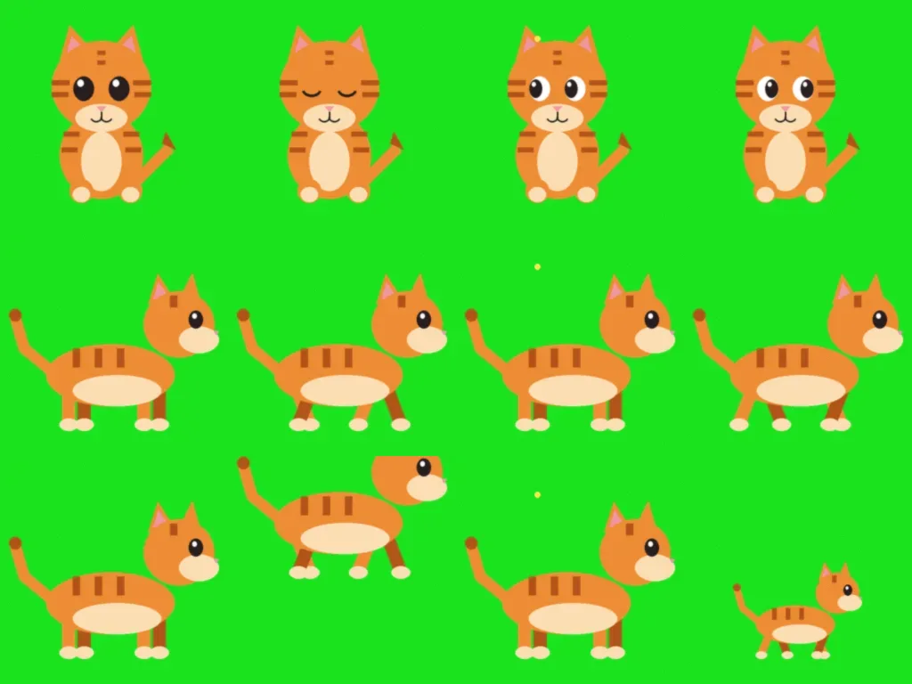

| 띠 | 자동 검사 | 결과 |
| --- | --- | --- |
| 서기 (위) | 문제 없음 | idle, blink, look-l, look-r |
| 걷기 (가운데) | 문제 없음 | walk-0 ~ walk-3 |
| 망친 걷기 (아래: 둘째 칸이 위로 잘림, 넷째 칸이 작음) | walk-1 잘림, walk-3 크기 튐 | 이 동작은 쓰지 않고 다시 만들기로 |

배경색은 요청한 `#00FF00` 이 아니라 띠 가장자리에서 잰 `#1AE31D` 로 지웠다. 다 만든 여덟 장 모두 완전 투명 화소의 색이 0 이고, 초록이 빨강, 파랑보다 40 넘게 센 화소가 0 개다 (겹친 다리 사이 틈까지. 처음 판은 이 틈에 초록 줄이 199 화소 남아 고쳤다).

## 다 만든 그림 세트

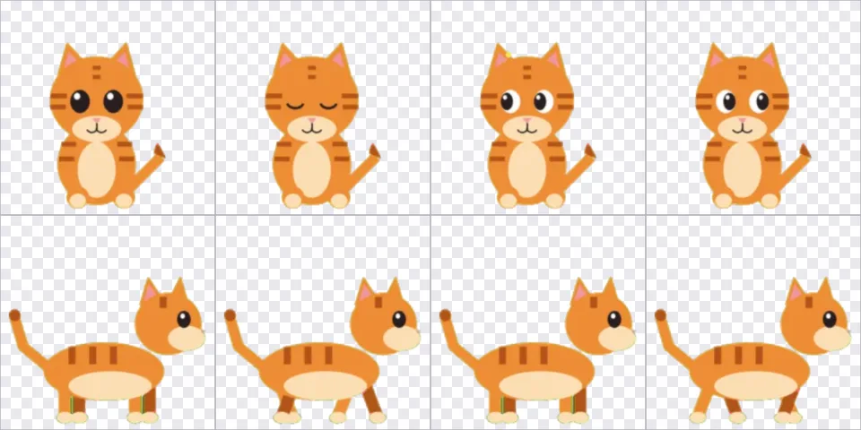

- 모두 320x320 PNG, 한 장 38~44KB, 여덟 장 합 327KB (한 장 512KB, 합 4MB 상한 안)
- 배율은 세트 전체에 하나라 서 있는 모습과 옆으로 걷는 모습의 크기 비가 그린 그대로다

## 전후 비교 (앱 화면에서 찍음)

지금 방식: 사진이나 말로 만든 페어리는 그림 한 장이라 걸을 때도 같은 그림이 조금 흔들릴 뿐이다.

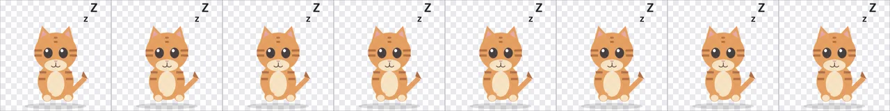 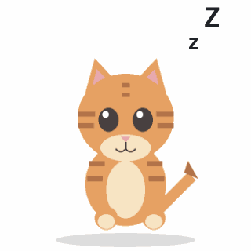

새 방식: 같은 페어리에 그림 세트를 저장하면 2D 모습에서 걷기 그림을 넘긴다 (펫 창 `__pet.debugRender` 로 걸음 진행 0~7/8 을 그림).

 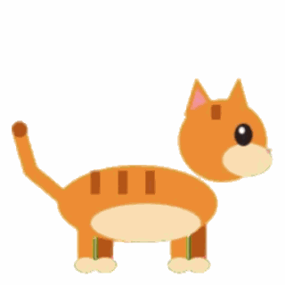

## 만들기 창 상태별 화면

가짜 Space(`__jj.maker.debugSpriteFetch`)로 각본을 돌렸다: 서기 됨, 걷기 검사 실패, 쉬기 무료 횟수 끝(멈춤), 다시 만들기에서 걷기 됨, 나머지는 바쁨.

| 상태 | 화면 |
| --- | --- |
| 그리는 중 (진행 표시, 몇 초째, 그만두기) | 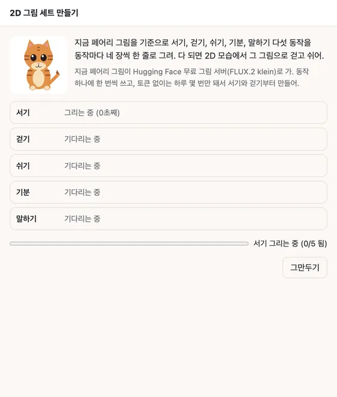 |
| 무료 횟수 끝: 남은 동작은 기다림으로 두고 안내 | 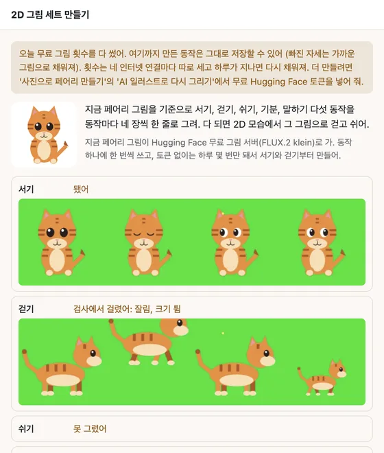 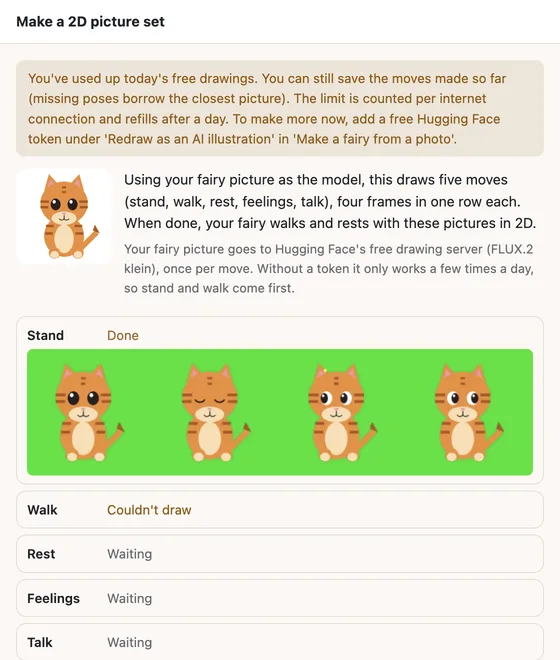 |
| 안 된 동작만 다시 만든 뒤 미리보기 (걷기 돌려 보기, 장마다) | 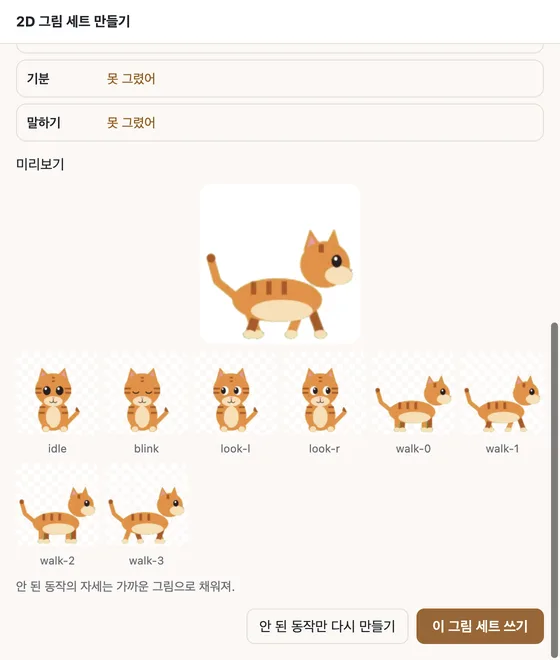 |
| 그만두기: 그리던 동작은 기다림으로, 안내 없음 | 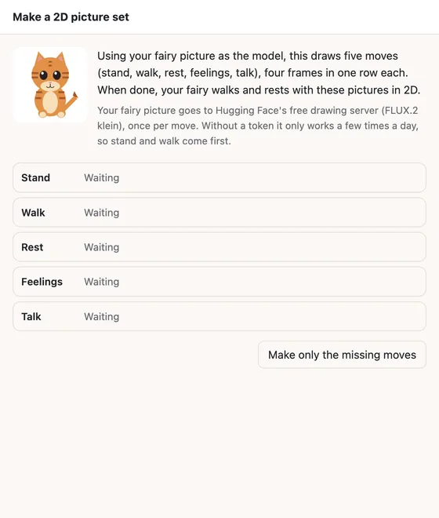 |
| 저장 (어두운 화면, 서기만 된 세트도 저장) | 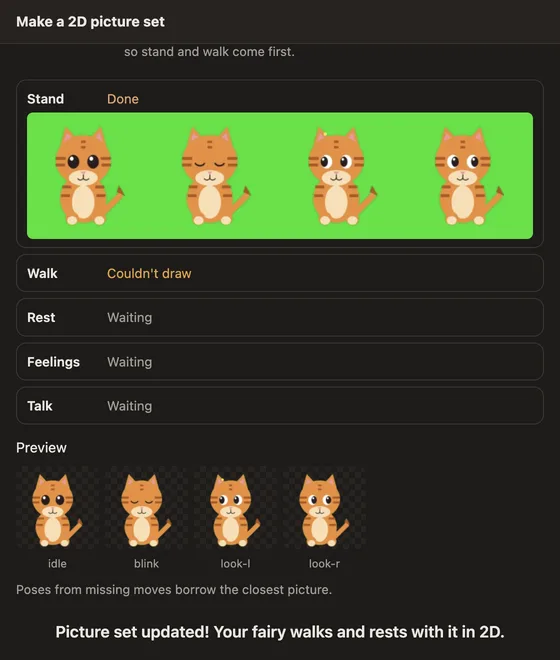 |
| 기본 페어리일 때 | 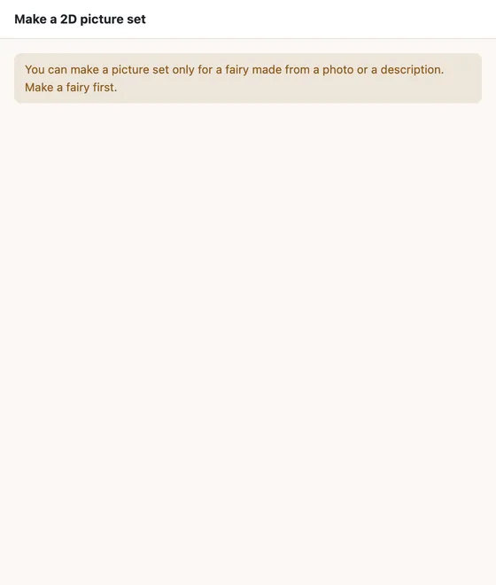 |
| 설정 → 페어리의 단추 (세트가 있으면 다시 만들기) | 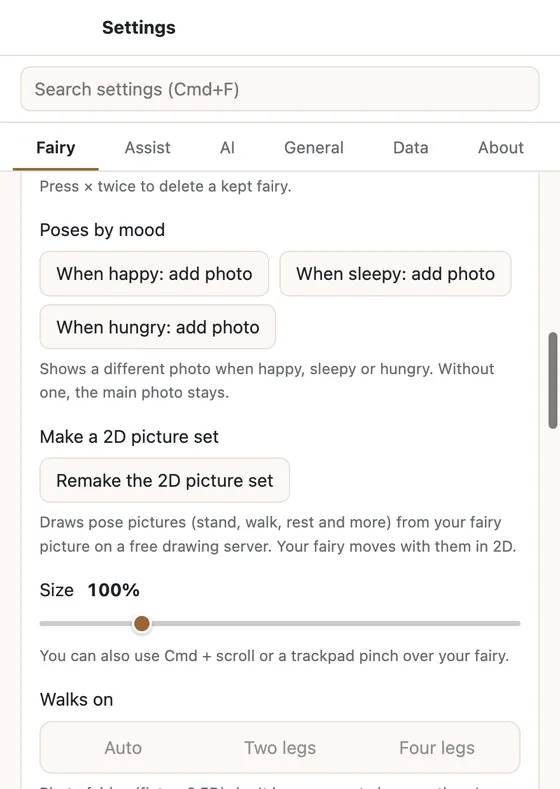 |

## 경계 상황

| 상황 | 동작 | 확인 |
| --- | --- | --- |
| 무료 횟수 끝 (quota, 이유 없는 거절) | 남은 동작을 시도하지 않고 멈춘다. 된 동작으로 저장 가능 | 앱 화면, `sprite-gen.test.ts` |
| 바쁨, 시간 초과, 이상한 답 | 그 동작만 실패, 다음 동작으로. 동작 아래에 까닭 | 앱 화면 (부름 5~7) |
| 그만두기 | 그리던 동작은 기다림으로. 받던 그림은 버린다 | 앱 화면, 시험 (fetch 가 signal 을 몰라도) |
| 검사 실패 (빈 칸, 잘림, 배경색 남음, 크기 튐, 칸 수) | 그 동작은 쓰지 않는다. 다시 만들기 대상 | `sprite-strip.test.ts` |
| 서기가 안 됨 | 서기는 지금 페어리 그림을 받은 칸 키에 맞춰 쓴다 | `sprite-strip.test.ts` |
| 만드는 사이 페어리가 바뀜 | 저장하지 않고 안내 | 코드 (`main.sprites.changed`) |
| 저장할 세트가 규칙에 안 맞음 | `.fairy` 가져오기와 같은 `cleanSprites` 로 다시 보고 거절 | 코드 |
| 기본 페어리 | 만들기 대신 안내 | 앱 화면 |
| 배경색 고르기 | 캐릭터에 가장 덜 쓰인 초록, 자홍, 파랑 | `sprite-strip.test.ts` |

## 다시 해 보기

순수 함수는 `node --test src/shared/sprite-strip.test.ts src/main/sprite-gen.test.ts`. 앱 화면은 시험 앱을 띄우고 메인 디버거에서 `__jj.maker.debugSpriteFetch(가짜 fetch)` 로 Space 를 바꾼 뒤 `__jj.maker.open('sprites')`.
