# 2D 그림 세트 만들기 시험 (#89)

2026-10-15, 맥(Apple Silicon), Electron 44.5.1. 시험 앱은 `JJ_NO_FOCUS=1`, 빈 `JJ_USER_DATA` 로 띄우고 CDP 로만 움직였다.

## 먼저 알 것: 이 그림들은 그림 모델이 그린 것이 아니다

실제 무료 Space(FLUX.2 klein 4B) 시험은 첫 부르기부터 이유 없는 거절(`event: error`, `data: null`)이 왔다. 앱의 다른 기록(hf-illust.ts)대로 이 거절은 대개 오늘 무료 횟수가 끝났을 때 오는 답이라, 규칙대로 바로 멈췄다 (글로 시험 고양이 그리기 한 번, 기준 그림을 넣은 걷기 띠 한 번, 모두 2회 부름. 둘 다 같은 거절이었고 다시 시도나 우회는 없다).

그래서 아래 그림의 띠는 **직접 그린 주황 줄무늬 고양이로 만든 합성 띠**다. 그림 Space 결과처럼 배경색을 조금 다르게(`#1AE31F`), 테두리를 흐리게(섞인 화소), 작은 점 하나, webp 손실 압축을 넣었다. 그림 모델이 정말로 네 칸을 같은 모습으로 그리는지는 아직 못 봤다. 무료 횟수가 다시 차면 같은 시험을 해서 이 문서에 더한다.

## 받은 띠 (합성)

| 띠 | 자동 검사 | 결과 |
| --- | --- | --- |
| 서기 (위) | 문제 없음 | idle, blink, look-l, look-r |
| 걷기 (가운데) | 문제 없음 | walk-0 ~ walk-3 |
| 망친 걷기 (아래: 둘째 칸이 위로 잘림, 넷째 칸이 작음) | walk-1 잘림, walk-3 크기 튐 | 이 동작은 쓰지 않고 다시 만들기로 |

배경색은 요청한 `#00FF00` 이 아니라 띠 가장자리에서 잰 `#1AE31D` 로 지웠다. 다 만든 여덟 장 모두 완전 투명 화소의 색이 0 이고, 초록이 빨강, 파랑보다 40 넘게 센 화소가 0 개다 (겹친 다리 사이 틈까지. 처음 판은 이 틈에 초록 줄이 199 화소 남아 고쳤다).

## 다 만든 그림 세트

- 모두 320x320 PNG, 한 장 38~44KB, 여덟 장 합 327KB (한 장 512KB, 합 4MB 상한 안)
- 배율은 세트 전체에 하나라 서 있는 모습과 옆으로 걷는 모습의 크기 비가 그린 그대로다

## 전후 비교 (앱 화면에서 찍음)

지금 방식: 사진이나 말로 만든 페어리는 그림 한 장이라 걸을 때도 같은 그림이 조금 흔들릴 뿐이다.

 

새 방식: 같은 페어리에 그림 세트를 저장하면 2D 모습에서 걷기 그림을 넘긴다 (펫 창 `__pet.debugRender` 로 걸음 진행 0~7/8 을 그림).

 

## 만들기 창 상태별 화면

가짜 Space(`__jj.maker.debugSpriteFetch`)로 각본을 돌렸다: 서기 됨, 걷기 검사 실패, 쉬기 무료 횟수 끝(멈춤), 다시 만들기에서 걷기 됨, 나머지는 바쁨.

| 상태 | 화면 |
| --- | --- |
| 그리는 중 (진행 표시, 몇 초째, 그만두기) |  |
| 무료 횟수 끝: 남은 동작은 기다림으로 두고 안내 |   |
| 안 된 동작만 다시 만든 뒤 미리보기 (걷기 돌려 보기, 장마다) |  |
| 그만두기: 그리던 동작은 기다림으로, 안내 없음 |  |
| 저장 (어두운 화면, 서기만 된 세트도 저장) |  |
| 기본 페어리일 때 |  |
| 설정 → 페어리의 단추 (세트가 있으면 다시 만들기) |  |

## 경계 상황

| 상황 | 동작 | 확인 |
| --- | --- | --- |
| 무료 횟수 끝 (quota, 이유 없는 거절) | 남은 동작을 시도하지 않고 멈춘다. 된 동작으로 저장 가능 | 앱 화면, `sprite-gen.test.ts` |
| 바쁨, 시간 초과, 이상한 답 | 그 동작만 실패, 다음 동작으로. 동작 아래에 까닭 | 앱 화면 (부름 5~7) |
| 그만두기 | 그리던 동작은 기다림으로. 받던 그림은 버린다 | 앱 화면, 시험 (fetch 가 signal 을 몰라도) |
| 검사 실패 (빈 칸, 잘림, 배경색 남음, 크기 튐, 칸 수) | 그 동작은 쓰지 않는다. 다시 만들기 대상 | `sprite-strip.test.ts` |
| 서기가 안 됨 | 서기는 지금 페어리 그림을 받은 칸 키에 맞춰 쓴다 | `sprite-strip.test.ts` |
| 만드는 사이 페어리가 바뀜 | 저장하지 않고 안내 | 코드 (`main.sprites.changed`) |
| 저장할 세트가 규칙에 안 맞음 | `.fairy` 가져오기와 같은 `cleanSprites` 로 다시 보고 거절 | 코드 |
| 기본 페어리 | 만들기 대신 안내 | 앱 화면 |
| 배경색 고르기 | 캐릭터에 가장 덜 쓰인 초록, 자홍, 파랑 | `sprite-strip.test.ts` |

## 그리는 길 두 개 더: 내 컴퓨터, 동작 하나만 Gemini (2026-10-15)

사용자 결정(2026-10-15) "둘 다 두자". 기본 흐름은 자동 다섯 동작(무료 서버 또는 내 컴퓨터) 뒤 마음에 안 드는 동작만 Gemini 로.

**먼저 알 것: 진짜 엔진은 하나도 부르지 않았다.** 무료 Space 는 가짜 fetch(`__jj.maker.debugSpriteFetch`), 내 컴퓨터 엔진은 가짜 그리기와 가짜 준비 상태(`__jj.maker.debugSpriteLocal`), 클립보드와 Gemini 열기와 Finder 보이기는 가로채기(`__jj.maker.debugSpriteOut`)로 바꿨다. 이 맥의 mflux 는 실행하지도 설치하지도 않았다. 띠와 Gemini 그림은 직접 그린 합성 고양이다. 그래서 진짜 klein 이 1024x256 띠를 네 칸으로 잘 그리는지, 진짜 Gemini 가 요청문대로 한 줄 그림을 주는지는 아직 못 봤다.

내 컴퓨터 길은 새 엔진을 만들지 않고 AI 일러스트의 엔진(`illustrateLocal`, mflux 또는 sd.cpp)을 그대로 쓴다. 바뀐 것은 크기 하나: 그 엔진은 넣은 그림 비율로 그리는데(`drawSize`), 띠는 `size` 로 1024x256 을 정해 넘긴다(`fixedDrawSize`, klein 규칙 16 의 배수 256~1024 를 지나도 그대로). CPU 판(sd.cpp, 긴 변 768)도 1024x256 은 768 판보다 넓이가 작아 그대로 둔다. 그린 그림 하한 40KB 는 768x1024 쯤 그림의 값이라 넓이가 1/3 인 띠에는 13.3KB(`STRIP_MIN_BYTES`)로 줄였다.

Gemini 길은 받은 그림을 `fitStrip` 이 먼저 맞춘다: 투명 PNG 면 배경색 위에, 오른쪽 아래 Gemini 표시는 덮고, 가장자리로 배경색을 잰 뒤(단색이 아니면 거절), 캐릭터 상자를 여백 두고 잘라 4:1 로 채우고 1024x256 으로 줄인다. 그 뒤는 서버 띠와 같은 `processStrip`. 그림 끝에 닿은 캐릭터는 닿은 채로 둬서 잘림 검사가 그대로 잡는다.

| 상황 | 동작 | 확인 |
| --- | --- | --- |
| 내 컴퓨터 준비됨 (Apple 칩 mflux) | 그리는 곳 고르기가 보인다. 걸리는 시간 안내, 그림이 밖으로 안 나간다는 안내 | 앱 화면 |
| 무료 횟수가 중간에 끝남 | 남은 동작을 멈추고, 준비됐으면 **남은 동작 내 컴퓨터에서 그리기**. 누르면 남은 동작만 내 컴퓨터로 (부름 `local:rest local:feel local:talk`, 크기 1024x256) | 앱 화면 |
| 내 컴퓨터 준비 전 | 고르기 없이 준비하는 곳만 안내. 횟수 끝 칸에도 같은 안내와 Gemini | 앱 화면 |
| 인텔 Mac, 칩이 안 됨 | 내 컴퓨터 이야기를 하지 않는다. 횟수 끝 칸에 Gemini 만 | 앱 화면 |
| 인텔 Mac sd.cpp CPU 준비됨 | 고를 수 있고 시간이 길게 (동작 하나 10~25분) | 앱 화면 |
| 내 컴퓨터 실패 (엔진이 멈춤, 시간 초과, 이상한 그림) | 그 동작만 실패, 다음 동작으로. 동작 아래에 까닭 | 앱 화면, `sprite-strip.test.ts` |
| 그리다 준비가 깨짐 (모델 지워짐 등) | 다음 동작에서 notReady 로 멈추고 그리는 곳을 서버로 돌리고 준비 안내 | 앱 화면 |
| 다른 그리기 중, 공간, 메모리, 배터리 | 남은 동작을 멈춘다 (서버의 바쁨은 다음으로 가지만 내 컴퓨터의 busy 는 멈춘다) | `sprite-strip.test.ts` |
| 내 컴퓨터로 그리다 그만두기 | 그리던 동작은 기다림으로. 엔진이 무엇을 던졌든 그만두기로 본다 | 앱 화면 |
| Gemini: 요청문, 열기, 기준 그림 | 동작과 배경색이 든 요청문을 복사(메인이 만든다), 여는 주소는 `https://gemini.google.com/app` 하나, 기준 그림 PNG 를 임시 폴더에 두고 보인다 | 앱 화면 (가로챈 값) |
| Gemini 그림 16:9 PNG, 2048x512 JPEG, 투명 PNG | 띠 비율에 맞추고 통과, 그 동작만 바뀐다. 크기를 맞췄다고 알린다 | 앱 화면, `sprite-strip.test.ts` |
| Gemini 그림 배경이 흰색 | 배경이 한 가지 색이 아니라고, 요청문 그대로 다시 | 앱 화면 |
| Gemini 그림 2x2 또는 한 장 | 네 장이 한 줄이 아니라고 | 앱 화면 |
| Gemini 그림 너무 큼 (5000px) | 4096px, 20MB 안으로 | 앱 화면 |
| 그림이 아닌 파일 | PNG, JPEG, WebP 만 | 앱 화면 |
| 잘린 Gemini 그림 | 이미 된 동작은 그대로 두고 까닭, 안 된 동작이면 검사 실패로 보인다 | 앱 화면 |
| 끌어 놓기 | 칸에 놓은 파일로 같은 처리 (창 안에서 만든 끌기 이벤트로 시험, 진짜 마우스 끌기는 아님) | 앱 화면 |
| 취소 | 칸 **닫기**: 아무 동작도 바뀌지 않는다 | 앱 화면 |

| 상태 | 화면 |
| --- | --- |
| 무료 횟수 끝, 내 컴퓨터로 이어 가기 권함 | 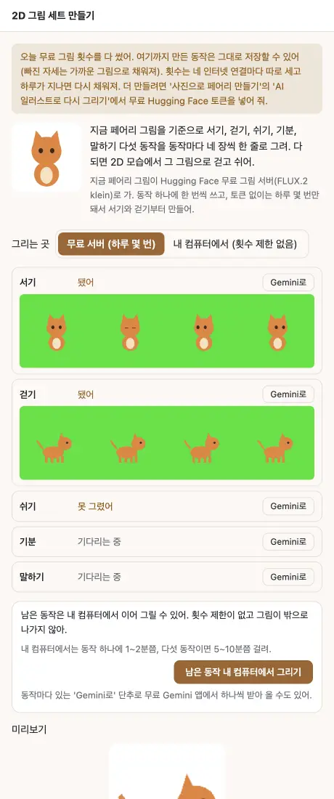 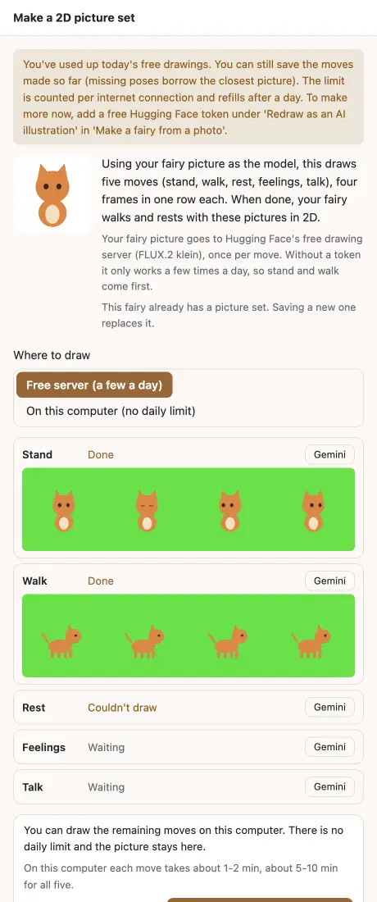 |
| 내 컴퓨터로 이어 그린 뒤 (한 동작은 엔진 실패) | 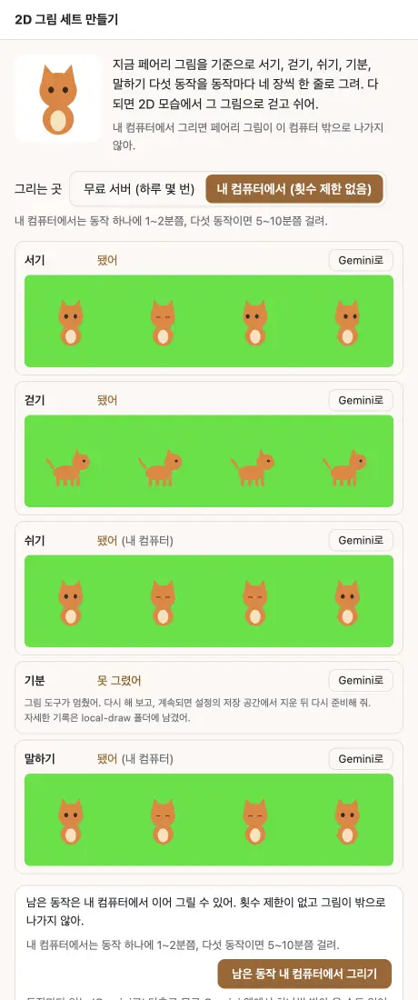 |
| 내 컴퓨터 준비 전, 횟수 끝 | 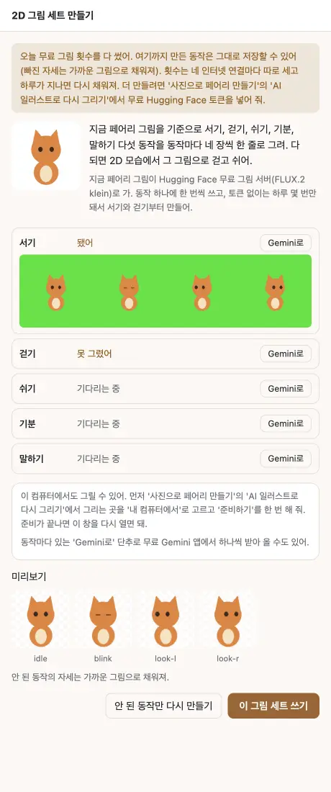 |
| 칩이 안 되는 인텔 Mac | 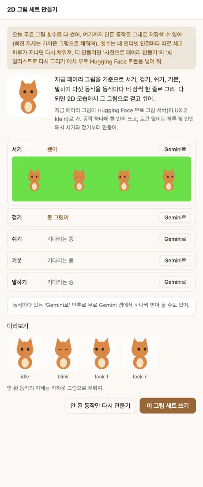 |
| 인텔 Mac CPU, 내 컴퓨터 고름 | 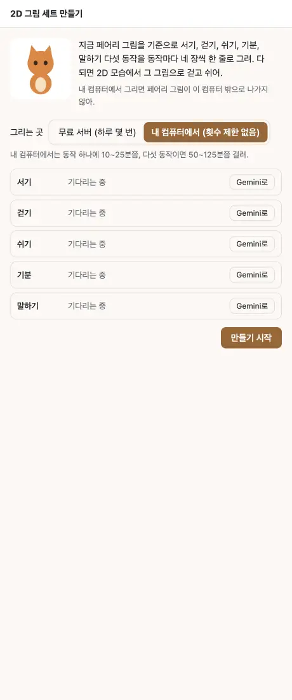 |
| 그리다 준비가 깨짐 | 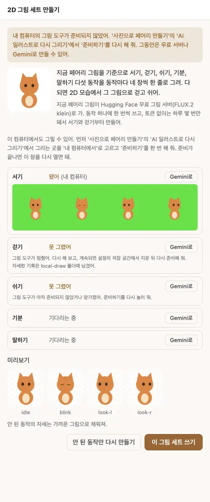 |
| 내 컴퓨터로 그리다 그만두기 | 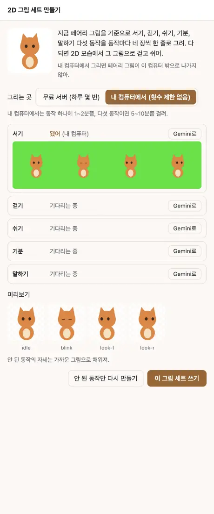 |
| 걷기만 Gemini 로 (펼친 칸) | 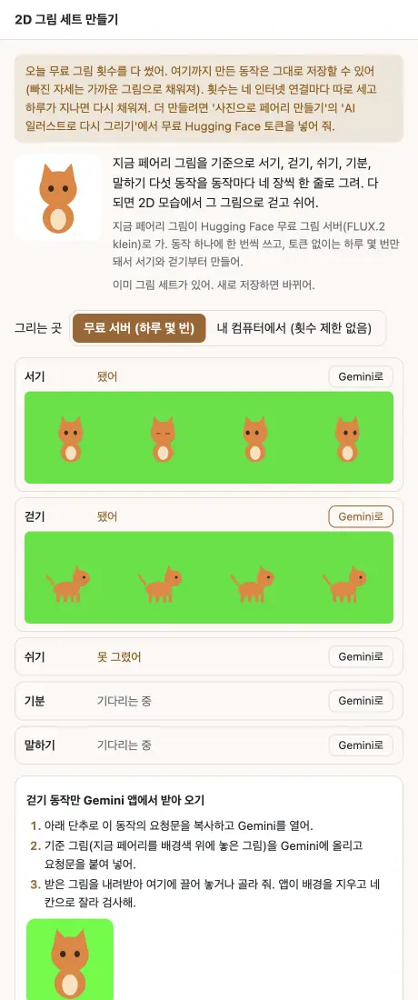  |
| 배경이 단색이 아닌 그림 | 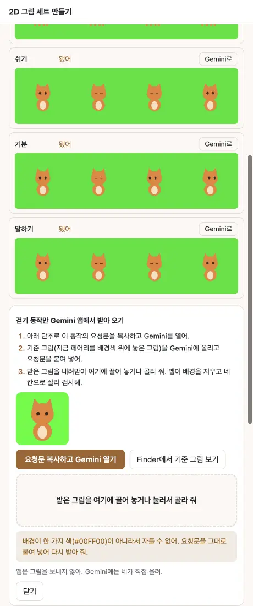 |
| 잘린 그림: 된 동작은 그대로 | 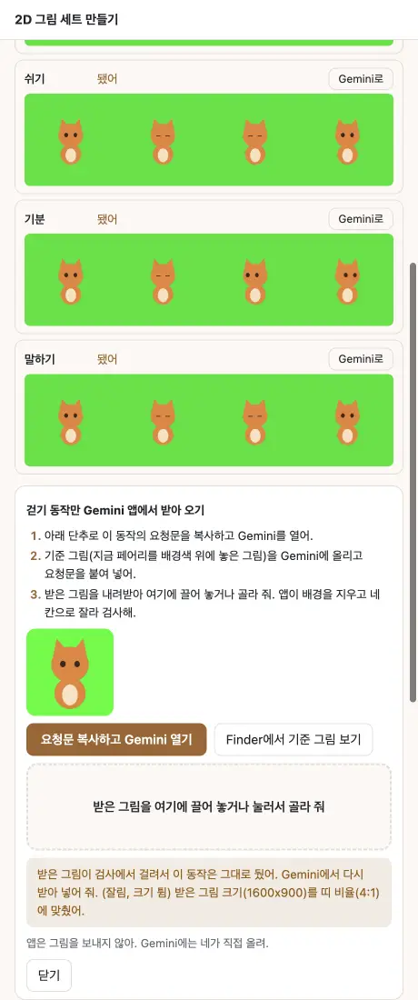 |
| 바뀐 뒤 (전: 서버 띠, 후: Gemini 띠) | 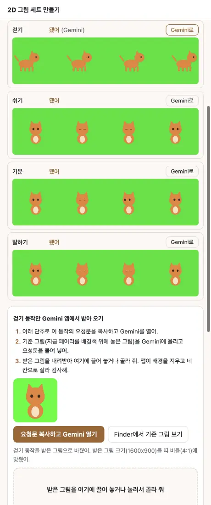 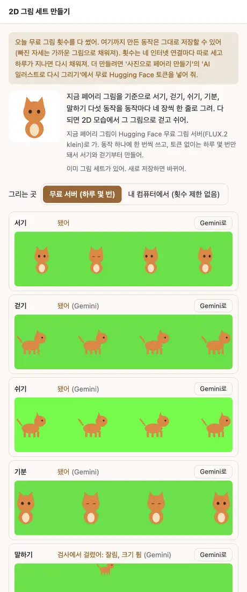 |

단위 시험은 고친 코드를 되돌리면 실패하는지 하나씩 봤다: 내 컴퓨터 멈춤 종류, 끝에 닿은 쪽 여백 없음, Gemini 표시 덮기, 투명 PNG, 띠 하한 바이트, 띠 크기 넘기기 모두 되돌리면 1건씩 실패.

## 다시 해 보기

순수 함수는 `node --test src/shared/sprite-strip.test.ts src/main/sprite-gen.test.ts`. 앱 화면은 시험 앱을 띄우고 메인 디버거에서 `__jj.maker.debugSpriteFetch(가짜 fetch)` 로 Space 를, `__jj.maker.debugSpriteLocal({ info, draw })` 로 내 컴퓨터 엔진을, `__jj.maker.debugSpriteOut({ copy, open, reveal })` 로 클립보드와 브라우저를 바꾼 뒤 `__jj.maker.open('sprites')`.

## 두 줄 시트: 서기 8칸, 걷기 8칸을 한 번 호출로 (2026-10-28)

그림 서버 호출은 동작 다섯 번 그대로이고, 서기와 걷기는 한 번에 1024x512 시트(한 줄 네 칸, 두 줄)로 받는다. 서기는 idle, blink, look-l, look-r, look-u, look-d, look-ul, look-ur, 걷기는 walk-0 ~ walk-7. 쉬기, 기분, 말하기는 1024x256 한 줄 네 칸 그대로.

**이 시험은 진짜 그림 모델로 하지 않았다.** `scripts/dev/sprites-sheet.mjs` 가 가짜 그림 서버(`__jj.maker.debugSpriteFetch`)로 합성 시트(주황 고양이, 단색 배경)를 돌려준다. 그림 모델(FLUX.2 klein)이 4x2 격자를 정말 요청대로 같은 모습으로 그리는지는 아직 못 봤다 (진짜 무료 횟수를 쓰지 않는다는 규칙). 첫 실제 시험에서 확인할 것: 줄이 두 개로 나오는지, 칸 안에 하나씩 들어가는지, 걷기 여덟 장의 걸음 순서가 이어지는지.

| 확인 | 결과 |
| --- | --- |
| 호출 수와 크기 | 다섯 번. 서기, 걷기 1024x512, 나머지 1024x256 |
| 다 된 세트 | 자세 28장 (기본 22 + walk-6, walk-7, look-u, look-d, look-ul, look-ur), 저장하면 펫 설정에 28장 |
| 펫 창 | 걷기 여덟 장이 모두 다르게 그려지고 위, 아래, 왼쪽 위, 오른쪽 위 시선과 정면이 모두 다르게 그려진다 |
| 걷기 시트의 일곱째 칸이 비었을 때 | 첫 줄(walk-0 ~ 3)이 온전해 그 줄만 쓰고 아래 줄 네 칸은 뺐다고 알린다. 호출은 다섯 번 그대로 |
| 첫 줄이 틀렸을 때 | 건지지 않고 그 동작을 검사에 걸린 것으로 둔다 (다시 만들기, 또는 Gemini 로) |
| 옛 앱이 만든 네 장 걷기 세트 | 그대로 읽혀 네 장 한 주기로 돈다 (예전에는 여섯 칸 주기에 네 장을 돌려 쓰며 절룩거렸다) |
| 화면 | ko, en, 밝음, 어두움, 폭 460 과 900. 가로로 넘치지 않고 두 줄 시트가 그대로 보인다 |

규칙 설명과 검사기: `docs/pet-format.md` "그림 세트 검사". 검사기 `node scripts/validate-pet.mjs 내펫.fairy`.
